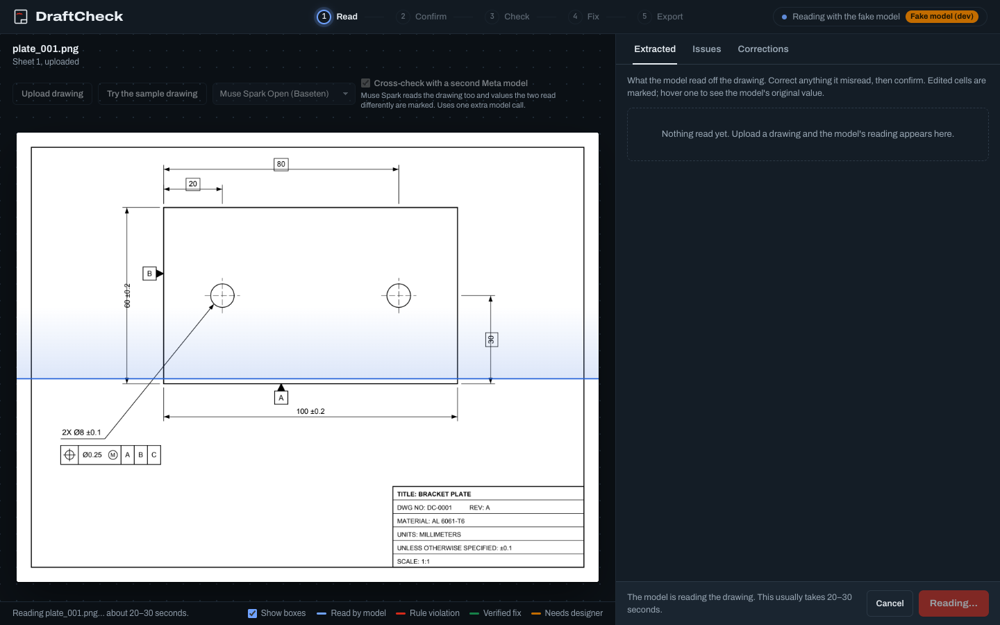
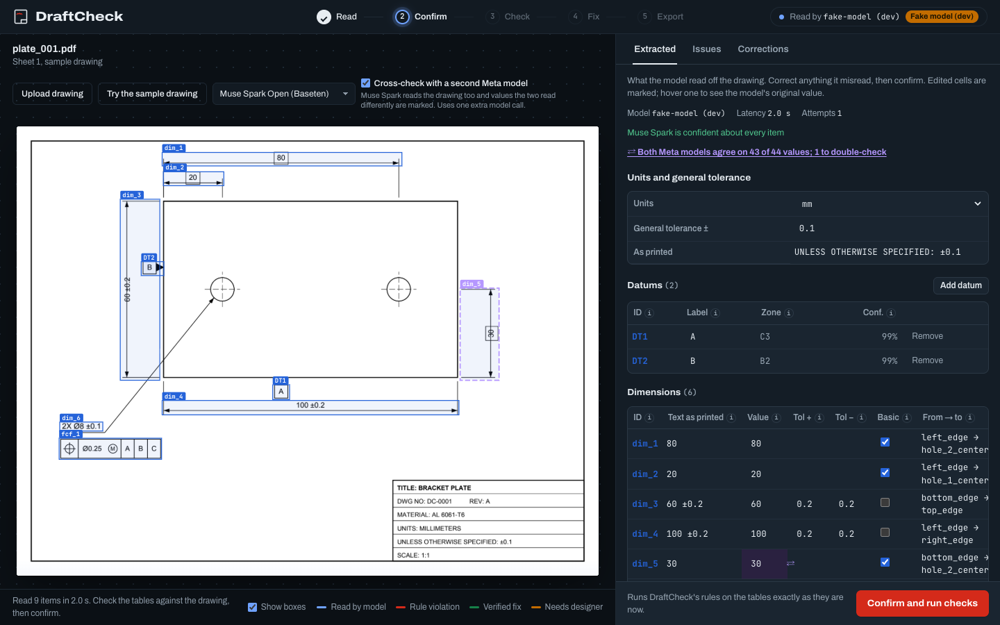
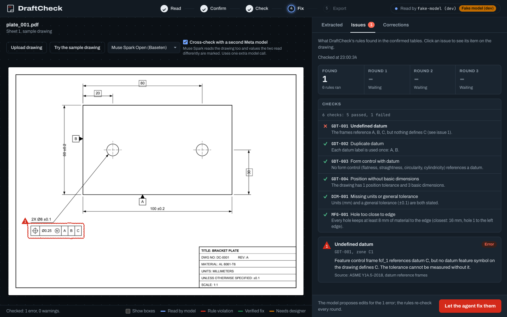
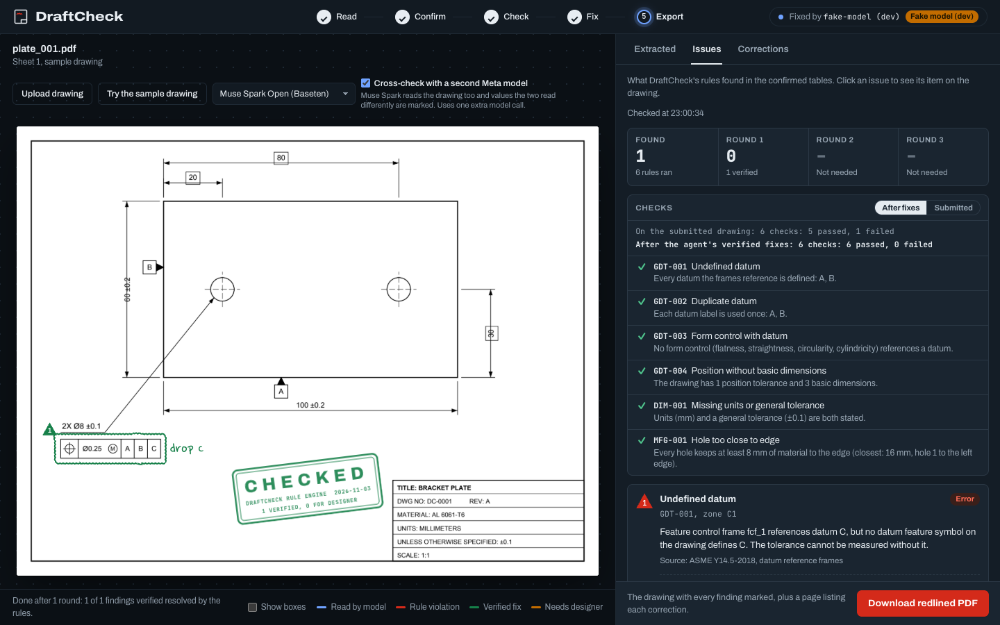
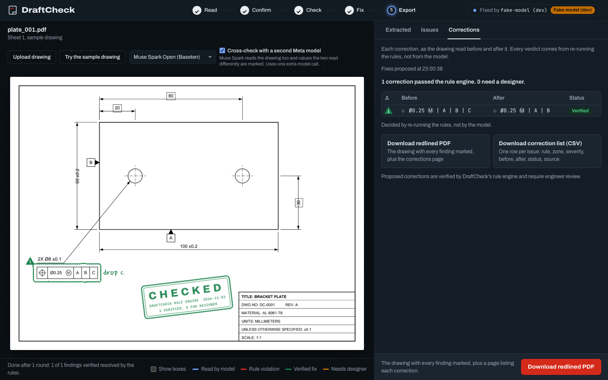
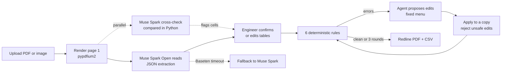

# DraftCheck

**DraftCheck: an AI checker that catches GD&T and dimensioning errors in engineering drawings before they reach the shop floor.**

- **Live app:** https://draftcheck.onrender.com. It runs on a free host that sleeps when idle, so the first load can take up to a minute.
- **Demo video:** TODO: link

---

## The problem

Every engineering drawing is checked by hand before it is released. The checker looks for datums a tolerance refers to that are never defined, dimensions with no tolerance, and holes placed too close to an edge. Checking is slow, and errors still get through. I am a mechanical engineer and I have worked on CAD software (Siemens, Solid Edge), and I have seen what happens next: the shop builds the part as drawn, and the mistake turns into rework or scrap.

## What it does

1. **Upload** a drawing (PDF or image), or try the built-in sample.
2. **Muse Spark reads it.** It turns the sheet into structured data: dimensions, tolerances, feature control frames, datums, units, and the general tolerance.
3. **The engineer confirms.** Every value is shown in an editable table next to the drawing, with a box around the item on the sheet. Low-confidence readings and cross-check disagreements are marked.
4. **Six rules check it.** These are deterministic Python checks, and each one reports pass, fail, or not applicable with a sentence that uses the drawing's own values.
5. **The agent proposes fixes.** For each error, the model suggests the smallest edit, with a one-sentence engineering reason.
6. **The rules verify the fixes.** Each proposed edit is applied to a copy of the data and the same rules run again. Only that re-run decides whether a fix worked.
7. **Export** a redlined PDF (marked-up sheet plus a page listing each correction) and a CSV of corrections.

The screenshots below were captured locally with the **dev fake model** (`DRAFTCHECK_FAKE_MODEL=1`), which returns a saved real reading of the sample drawing so the page can be shown without calling a live model. The rules, the correction loop, and the redline all ran for real.

| Reading | Confirm |
| --- | --- |
|  |  |
| **Checked** | **Done** |
|  |  |



## How it uses Meta's models

| Model | Where it runs | What DraftCheck uses it for |
| --- | --- | --- |
| **Muse Spark Open** (open-weight) | Baseten | The default. Reads the drawing and runs every round of the correction loop. |
| **Muse Spark** | Meta Model API | (1) An **independent cross-check reader**: it reads the same page at the same time, and any value the two models read differently is flagged for the engineer to review. (2) An **automatic fallback**: if Baseten does not answer a call in time, fails to connect, or returns a server error, that one call is sent to Muse Spark instead. |

**What the models do:**

- Vision extraction: read the drawing image and return structured JSON.
- Say what each dimension measures between (for example `left_edge` → `hole_1_center`), so the rules can reason about geometry.
- Give a confidence for each item they read.
- Propose edits to fix rule violations, each with an engineering reason.
- Revise their proposals after the code rejects an edit, using the rejection reason.

**What the models never do:** decide whether a rule passes or fails.

## Core principle

> **The model reads and reasons; deterministic Python decides.**

Safeguards that enforce it:

- **A fixed edit menu.** The agent can only propose four operations: set a field, add a datum, remove a datum reference from a frame, or add a dimension.
- **No deletions.** There is no operation that deletes a dimension, frame, or datum, and a backstop check rejects any edit that would make an existing item disappear. Deleting a callout is the cheapest way to make a finding go away, so it is not allowed.
- **Verdicts only come from re-running the rules.** The model's claim that its fix worked is recorded but never used.
- **A 3-round cap** on the correction loop.
- **Every rule explains itself** from real values: "The frames reference A, B, C, but nothing defines C."
- **Fixes are proposals.** They are marked for engineer review, and the CLI's exit code always describes the drawing as submitted.

## Results

Nine generated drawings, each run end to end (read → rules → correction loop) once per model. Scores are computed in Python against each drawing's ground truth. Totals from [docs/EVAL.md](docs/EVAL.md):

| | Muse Spark Open (Baseten) | Muse Spark (Meta Model API) |
| --- | --- | --- |
| Dimensions correct | 62/63 | 63/63 |
| Feature control frames correct | 12/12 | 12/12 |
| Datums found | 20/20 | 20/20 |
| Seeded issues caught | 10/10 | 9/10 |
| False alarms | 0 | 0 |
| Fixes verified by the rules | 8/8 | 8/8 |
| Average latency per drawing* | 60.6 s | 23.9 s |
| Runs that used the fallback | 4 of 9 | 0 of 9 |

\* Total latency in EVAL.md divided by 9 runs (545.8 s and 215.1 s).

The drawings:

| Drawing | What it tests |
| --- | --- |
| plate_001 | The original sample: a position frame that references datum C, which is never defined |
| plate_clean | No errors at all, to check for false alarms |
| plate_dup_datum | Two datum symbols both labelled A |
| plate_flatness_datum | A flatness tolerance that references a datum |
| plate_no_basic | A position tolerance with no basic dimensions |
| plate_no_gentol | No general tolerance, and a dimension with no tolerance of its own |
| plate_edge_hole | A Ø6 hole centred 5 mm from an edge |
| bracket_01 | Front and side views, notes, full title block, with three seeded issues (undefined datum, flatness with a datum, hole near an edge) |
| plate_inch_multi | Inch units, four holes, two frames, datum B defined twice |

**Be aware:** these are drawings I generated with a script, not real production drawings, so they are cleaner than what a shop sees. Muse Spark's one miss was the MFG-001 hole-to-edge warning on the complex bracket (bracket_01); it caught both errors on that drawing. Muse Spark Open's one wrong dimension was on plate_no_gentol.

## Architecture



Full design, data flow, and decision log: [docs/ARCHITECTURE.md](docs/ARCHITECTURE.md).

## The rules

| Id | What it checks | Severity |
| --- | --- | --- |
| GDT-001 | A feature control frame refers to a datum letter that no datum symbol on the drawing defines | error |
| GDT-002 | The same datum letter is defined more than once | error |
| GDT-003 | A form tolerance (flatness, straightness, circularity, cylindricity) references a datum, which has no meaning | error |
| GDT-004 | The drawing has a position tolerance but no basic dimensions anywhere | error |
| DIM-001 | Units are missing, or there is no general tolerance while some dimension has no tolerance of its own | error |
| MFG-001 | A hole leaves less material between its wall and an edge than one hole diameter | warning |

Each rule is written in my own words and has a `source` field that cites its reference by topic (for example "ASME Y14.5-2018, datum reference frames"). MFG-001 cites general design-for-manufacturing practice, and its threshold is a named constant you can tune. No standards text is copied into the code.

## Engineering

- **595 tests** (`pytest`), plus `ruff` linting.
- **CI on every pull request** (GitHub Actions runs ruff and pytest), and **branch protection** on `main` requires CI to pass.
- **Usage limits** for the free demo: 5 uploads and 10 fix requests per IP per hour, and 100 model calls per day across everyone. Uploaded drawings are deleted after 24 hours.
- **Cancel** buttons for reading and fixing. Cancel reaches the server and aborts the model call.
- **Time limits:** each model call has a 90 s limit on the deployed server.
- **Fallback:** a Baseten call with no answer after 45 s is sent once to the Meta Model API. Who answered is recorded on the page, in the files, and on the redline stamp.
- **Cross-check:** the second reading gets at most 20 s after the first one returns, then the upload continues without it.
- **Production fixes:**
  - *Server freezing during uploads.* The model call blocked the thread that answers health checks, so the host could decide the app had died and restart it mid-upload. Slow work now runs on worker threads, and a test checks that `/healthz` still answers while a model call is in progress.
  - *Render memory.* Large multi-page PDFs pushed the free plan past its memory limit. Now only page 1 is rendered, once, at a capped size, and each stage logs memory use.

## Run it locally

Requires Python 3.12.

```bash
python3.12 -m venv .venv
```

```bash
source .venv/bin/activate
```

```bash
pip install -r requirements.txt
```

Create a `.env` file in the project root with these variables (values come from your own Baseten and Meta accounts):

```
LLM_PROVIDER=baseten
BASETEN_BASE_URL=
BASETEN_MODEL=
BASETEN_API_KEY=
META_BASE_URL=
META_MODEL=
META_API_KEY=
```

Start the web app, then open http://127.0.0.1:8000:

```bash
uvicorn draftcheck.api:app --reload
```

Check a drawing from the command line (fix loop and redline included):

```bash
python -m draftcheck.cli check samples/generated/plate_001.pdf --fix --redline
```

Run the evaluation (calls both models and rewrites `docs/EVAL.md`):

```bash
python -m scripts.run_eval
```

For UI work with no model calls, start the app with the fake model. It only answers requests from your own machine:

```bash
DRAFTCHECK_FAKE_MODEL=1 uvicorn draftcheck.api:app --reload
```

Run the tests and linter:

```bash
pytest
```

```bash
ruff check .
```

## Limitations

- Only page 1 of a drawing is read.
- Only 6 rules so far.
- The bounding boxes the model returns vary in accuracy, so a highlight box may be slightly off its callout.
- Rules that depend on what a dimension measures between (MFG-001) rely on the model's endpoint labels.
- MFG-001 checks every hole against the largest hole diameter on the drawing, which is conservative but not exact.
- Baseten calls occasionally hang. The fallback handles it, but those runs are slower.
- The free host sleeps when idle, so the first visit can take up to a minute.
- Fixes are proposals for an engineer to review, not edits to the CAD model.

## Roadmap

- Check the notes on the drawing.
- Check BOM tables.
- More rules.
- Per-hole diameters for MFG-001.
- SAM 3.1 for precise regions around each callout.
- Redlines written back into CAD-native formats.

## Built during the hackathon

Everything in this repo was written from Oct 27 to Nov 4, 2026, during the Meta Global AI Developer Hackathon. The code was written with Claude Code under my direction. The architecture, rule design, and engineering review are mine.

## License

[MIT](LICENSE)
