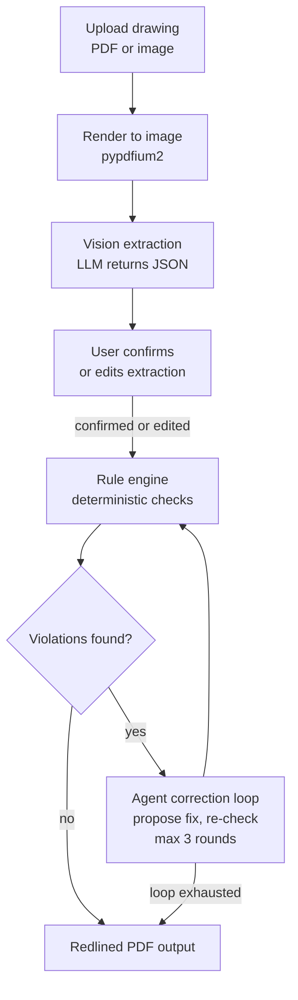

# DraftCheck — Architecture

Every item below is marked **BUILT** (exists in this repo today) or **PLANNED** (designed,
not yet written).

Last updated: 2026-11-03

## 1. Overview

DraftCheck reads an engineering drawing (PDF or image) and extracts its dimensions, GD&T
callouts, notes, and title-block data into structured JSON. It then checks that data
against a rule set covering dimensioning, GD&T, and manufacturability, and proposes a
correction for every violation it finds. The result is a redlined PDF showing each error
and the suggested fix.

## 2. Core principle

**The LLM reads and reasons; deterministic Python decides pass/fail.**

The model is used only for perception and explanation — turning pixels into structured
facts, and turning a rule violation into wording a person can act on. Whether a rule
passes is always computed in plain Python from the extracted data, so the same drawing
always produces the same verdicts. No rule outcome is ever read out of a model response.

## 3. Pipeline — PARTLY BUILT

Render, Extract, Check, Correct, and the redlined PDF output work today. The
user-confirmation step is still planned.



Stage notes:

| Stage | What happens | Status |
| --- | --- | --- |
| Render | PDF page rasterized to an image the model can see, via `render.load_pages` | **BUILT** |
| Extract | Model returns a JSON object; parsed by `llm_parsing.extract_json`, then validated by `schema.parse_drawing`. Wired up as `pipeline.extract` | **BUILT** |
| Confirm | User reviews and edits the extracted values before any checking. Over HTTP today: the extraction goes back from `POST /api/runs` and the (possibly edited) data comes in to `POST /api/runs/{id}/check`. The browser screen itself is the next step | **PARTLY BUILT** (API only) |
| Check | Python rules produce pass/fail per rule, with no model involvement, via `rules.run_rules`, wrapped as `pipeline.check` | **BUILT** |
| Correct | Agent proposes edits from a fixed menu, Python applies the safe ones and re-runs the rules to verify; **max 3 rounds**, then stop. `agent.correct`, see §4.5 | **BUILT** |
| Output | Two-page redline: the drawing with a numbered marker per located finding, and a findings page behind it. `redline.render_redline` / `redline.save_redline`, see §4.7 | **BUILT** |

Render → Extract → Check → Correct runs end to end today from one command,
`python -m draftcheck.cli check --fix` — see §4.3.

The 3-round cap is a hard stop: if a proposed correction still fails, the finding is
reported unresolved rather than retried indefinitely.

## 4. Components

| Module | Role | Status |
| --- | --- | --- |
| `draftcheck/llm_parsing.py` | Pulls a single JSON object out of model output; strips `<think>` blocks and code fences; raises `JSONParseError` with the raw text attached | **BUILT** |
| `draftcheck/config.py` | Locates `.env` with `find_dotenv` and builds a frozen `Provider` (name, base_url, model, api_key) for one of the providers in `PROVIDER_ENV_VARS` — see §4.4; raises `ConfigError` naming any missing variable, and masks the key in `repr` | **BUILT** |
| `draftcheck/llm_client.py` | `LLMClient.chat(system, user)` over the configured provider's OpenAI-compatible endpoint at `temperature=0`; `chat_json(system, user, images)` additionally sends PNG pages as `image_url` data URIs, parses the reply with `extract_json`, and retries once on `JSONParseError`. Both return latency, token usage, and model id | **BUILT** |
| `draftcheck/render.py` | `load_pages(path, dpi, max_side, max_pages)` rasterizes a PDF with pypdfium2 or loads a PNG/JPG with pillow; returns `PageImage` (PNG bytes, width, height) per page, scaled down to `max_side`. A PDF page is drawn at a scale already capped to `max_side` (`render_scale`), so pdfium never builds a bitmap bigger than the one that is kept, and `max_pages=1` skips the pages nobody uses. **`RenderError` is the only error it raises**: pypdfium2's `PdfiumError` and pillow's `UnidentifiedImageError` are both translated, so a file named `.pdf` that is not one becomes the CLI's exit 2 and the API's 400 rather than a traceback | **BUILT** |
| `draftcheck/prompts.py` | `EXTRACTION_SYSTEM` and `EXTRACTION_USER`: the model is a transcription engine that reports what is printed and never invents or repairs a callout; the user prompt fixes the JSON key set and the field rules, including each dimension's `from_ref`/`to_ref` endpoints (§4.2). `CORRECTION_SYSTEM` and `correction_user(drawing_json, findings, history)`: the model is a drawing checker proposing the smallest edits that preserve design intent, one rationale sentence each, citing the finding ids it addresses. The operation catalogue in the user prompt is generated from `edits.ALLOWED_OPS` and `edits.DIMENSION_FIELDS`, so it cannot drift from what the code accepts | **BUILT** |
| `draftcheck/schema.py` | pydantic v2 models for the extracted drawing (`Drawing`, `Dimension`, `FCF`, `DatumFeature`, `DatumRef`, `TitleBlock`, `GeneralTolerance`) and for rule output (`Finding`); `Units` and the 14-value `Characteristic` enum, plus `FORM_CONTROLS`. `parse_drawing(data)` validates a raw extraction dict: unknown keys are ignored, missing ids become `DT1…`/`D1…`/`F1…` (datums, dimensions, frames), and any item it cannot read is dropped into `Drawing.parse_issues`. `finding_key(finding)` names one finding as `<rule id>@<item ids>`, which is how rounds are compared and how the model cites a finding. `DatumFeature.location` is an optional plain-words description of where a symbol belongs: extraction leaves it empty, since a transcribed symbol already has a `bbox`, and the correction loop fills it in when it proposes a datum that is not on the sheet yet | **BUILT** |
| `draftcheck/rules.py` | `Rule` dataclass (id, title, category, severity, `source`, `check`), the `RULES` registry, and `run_rules(drawing)`. Six rules today — see §4.1. Output is sorted by rule id then item ids, so the same drawing always gives the same list | **BUILT** |
| `draftcheck/pipeline.py` | The two stages of one run, with no printing and no argument parsing, so the CLI and later the API can both drive them. `extract(path, client, dpi)` renders **page 1 only** and hands the PNG to `extract_page(png_bytes, client)`, which calls `chat_json` with the extraction prompts and validates the reply with `parse_drawing` (the API calls `extract_page` directly with the page it already rendered); it returns an `ExtractionResult` (the `Drawing` plus raw reply text, latency, model id, token usage, attempts). `check(drawing)` wraps `run_rules` | **BUILT** |
| `draftcheck/cli.py` | The `check` subcommand — see §4.3. Writes the run's files, prints the findings table and any `parse_issues`, and sets the exit code | **BUILT** |
| `draftcheck/edits.py` | The four operations the agent may propose — `set_field`, `add_datum`, `remove_datum_ref`, `add_dimension` — as pydantic models, plus `apply_edits(drawing, edits)` returning `(new_drawing, applied, rejected)`. Applies one edit at a time to a copy, re-validating the whole drawing after each, and refuses anything that deletes a feature, touches a protected field, names an unknown id, uses an unknown operation, or silently fails to take. Never raises on bad model output — see §4.6 | **BUILT** |
| `draftcheck/agent.py` | `correct(drawing, image_png, client, max_rounds=3)` → `CorrectionReport`. One round = ask, apply, re-run `rules.run_rules`, diff the findings. Records `proposed`, `applied`, `rejected`, findings before and after, `resolved`, and `introduced` per round, and a resolved/unresolved verdict per original finding — all computed from the re-run, never from the model's claim. Stops when no error-severity finding is left or after `max_rounds` — see §4.5 | **BUILT** |
| `draftcheck/redline.py` | `render_redline(page_png, findings, report=None, model_name=None, when=None)` → two pillow pages, and `save_redline(pages, path_pdf, path_png)` → a 2-page PDF plus page 1 as a PNG. Pillow only, drawn on the rendered page image. Markers are numbered in `run_rules` order, so a number means the same finding on page 1, on page 2, and in `findings.json`. `findings_text(findings, report)` returns page 2's wording as styled lines, so the text can be tested without reading pixels — see §4.7 | **BUILT** |
| `draftcheck/api.py` | FastAPI app over the same four modules the CLI drives: upload + extract, check the confirmed data, run the correction loop, serve the page image and the redline. One run is one folder under `outputs/web/<uuid4>/`, so each request reads what the previous one wrote — see §4.8. Decides nothing itself | **BUILT** |
| `draftcheck/limits.py` | What one demo deployment is willing to spend, and on whom. `Limits.from_env()` holds every number (per-IP uploads and fixes per hour, model calls per day, run retention, sweep interval, `TRUST_PROXY`); `UsageLimiter` counts them in memory over sliding windows and raises `LimitExceeded`, which `api.py` turns into a `429`; `client_ip(...)` decides which address a request is counted against; `sweep_runs(root, max_age_hours)` deletes stale run folders and `Cleaner` keeps that to once an hour — see §4.12 | **BUILT** |
| `draftcheck/static/` | The browser page, served at `/`: `index.html`, `style.css`, `app.js`, `sheet.js` (the drawing primitives for the sheet: scan band, revision clouds, pen notes, stamp — §4.17), and `fonts/` (Archivo, JetBrains Mono, Nanum Pen Script, each with its OFL licence). Plain HTML, CSS, and JavaScript — no framework, no build step, nothing loaded from a CDN. Laid out as "the checker's desk" (§4.15): a header with a five-stage stepper and a model pill, the drawing as paper on a dark desk with an SVG overlay in image pixels, and a tabbed review panel (Extracted, Issues, Corrections) with one primary button whose label follows the stage. The tables are editable (§4.9), linked to the drawing by item id, and checked and fixed through the same endpoints as before. Cells are written with `textContent` or as an input's `value`, so model output is never treated as markup | **BUILT** (upload + view + edit + check + fix + redline) |
| `frontend/` | Driving `/fix` from the page and showing the correction report and the redline | PLANNED |
| `scripts/make_sample_drawing.py` | Generates a synthetic drawing (reportlab) with its ground-truth JSON and a PNG preview; seeds a known error so the rule engine has something to catch. The ground truth is written in `schema.py`'s field names — plus `bbox_convention` and `seeded_errors` — so it parses as a `Drawing` and doubles as the target an extraction is scored against | **BUILT** |
| `scripts/smoke_test.py` | One-shot check that the configured model answers over the network; `--provider baseten\|meta` picks which one | **BUILT** |
| `scripts/extract_spike.py` | One extraction pass on a drawing: renders it, calls `chat_json`, and writes `outputs/spike/<name>.raw.txt`, `.json`, and `.overlay.png` (red boxes = model bboxes, green = ground truth from `--gt`). A look-at-it tool; it decides nothing | **BUILT** |

Rule text is always written in our own words with a `source` citation — no standards text
is copied into the code.

### 4.1 Rules in `rules.py` — BUILT

| Id | Title | Category | Severity | What it catches |
| --- | --- | --- | --- | --- |
| GDT-001 | Undefined datum | gdt | error | A feature control frame cites a datum letter that no datum feature symbol on the drawing defines, so the tolerance cannot be measured. One finding per frame per missing letter |
| GDT-002 | Duplicate datum | gdt | error | The same datum letter is defined more than once, so two features both claim it and an inspector cannot tell which to measure from |
| GDT-003 | Form control with datum | gdt | error | A control in `FORM_CONTROLS` (flatness, straightness, circularity, cylindricity) carries datum references. A form control describes one feature's own shape, so a datum on it has no meaning |
| GDT-004 | Position without basic dimensions | gdt | error | The drawing has a position tolerance but no basic dimensions anywhere, so no true location is established. **Drawing-level, not per-feature** — see the limitation below |
| DIM-001 | Missing units or general tolerance | dimensioning | error | Units are absent; and/or there is no general tolerance while some dimension carries none of its own and is neither basic nor reference, leaving it with no permitted range. Reports the two problems as separate findings |
| MFG-001 | Hole too close to edge | manufacturability | warning | A hole leaves less solid material between its wall and a part edge than `MIN_EDGE_MATERIAL_RATIO` × the hole diameter (1.0 today), so the web can tear out or bulge when the hole is drilled or punched. One finding per hole per failing edge |

Every finding names the offending item's id(s) and its bounding box, so the redline stage
can draw it in the right place.

#### MFG-001 — how the distance is worked out

The rule reads geometry out of each dimension's `from_ref`/`to_ref` pair (see §4.2):

- **Hole diameter** comes from a dimension whose `feature_type` is `diameter`. With more
  than one, the largest is used — a bigger hole leaves less material, so that is the
  conservative read. With none, the rule computes nothing and stays silent.
- **Material left** for a dimension running from an edge to `hole_N_center` is
  `value − diameter / 2`, i.e. the hole's wall, not its centre, to the edge.
- **The facing edge** is usually not dimensioned. When an overall size spans the part
  (`left_edge`→`right_edge`, or `bottom_edge`→`top_edge`), the distance to the opposite
  edge is derived as `overall − value`. A printed distance always wins over a derived one
  for the same hole and edge. A derived finding names both dimensions it used.

The threshold is a default, not a standard: `MIN_EDGE_MATERIAL_RATIO` in `rules.py` is
meant to be tuned per process and material.

Known limitation — GDT-004 only asks whether the drawing has any basic dimensions at all.
It cannot yet tell whether the basic dimensions present actually locate the feature a given
position frame applies to; that needs per-feature use of the `from_ref`/`to_ref` links.

### 4.2 Dimension endpoints: `from_ref` and `to_ref` — BUILT

A dimension's value alone is just a number. `from_ref` and `to_ref` say what it measures
between, which is what turns "20" into "the left edge to hole 1's centre" — the fact
MFG-001 needs. Extraction asks for one of: `left_edge`, `right_edge`, `top_edge`,
`bottom_edge`, `hole_N_center` (holes numbered left to right, then top to bottom),
`datum_X`, or `null` when the model cannot tell.

When a dimension lands on a physical edge the prompt asks for the edge name even if that
edge also carries a datum feature symbol — the rule needs geometry, and on plate_001 the
left edge is also datum B. Both fields stay optional in the schema: a drawing with no
endpoint information parses fine, and MFG-001 simply has nothing to check.

On the 2026-10-29 spike run the model filled all six of plate_001's dimensions correctly,
including both overall sizes and both hole locations.

### 4.3 The `check` command — BUILT

```
python -m draftcheck.cli check <drawing> [--from-json path] [--provider baseten|meta]
                                         [--fix] [--redline] [--out dir] [--dpi n]
```

`--fix` runs the correction loop after the check (§4.5) and prints, per round, what was
proposed, what was applied with its rationale, what was rejected and why, and which
findings cleared or appeared — then a status table of the findings the drawing started
with. It calls the model even under `--from-json`, because the saved extraction only
covers the check.

`--fix` does **not** change the exit code, which always describes the drawing as
submitted. A drawing whose errors the loop resolved still exits `1`, and the run says so
on its last line:

```
Agent proposals are unreviewed; original drawing has 1 error(s).
```

`--redline` writes `redline.pdf` and `redline.png` to the output folder (§4.7). It works
with or without `--fix`; with `--fix` the findings page also carries each applied edit, its
rationale, and the rule engine's verdict on whether the finding cleared.

`--provider` chooses the model to call (§4.4); with no flag it follows `LLM_PROVIDER` in
`.env`. The run prints the provider and the model id before calling.

`--from-json` loads a saved extraction instead of calling the model, which makes a run
free, offline, and repeatable; it is how the CLI tests exercise the whole command. The
drawing is still rendered in that mode, so a bad path fails loudly rather than appearing
to pass on a saved extraction.

Each run writes to `--out`, defaulting to `outputs/runs/<drawing-name>/`:

| File | Contents |
| --- | --- |
| `extraction.json` | The validated `Drawing`, including `parse_issues` |
| `findings.json` | The findings list, in `run_rules` order |
| `raw.txt` | The model's reply exactly as received. **Only written when the model ran** |
| `corrections.json` | Every round (proposed, applied, rejected with reasons, findings before and after, resolved, introduced), the per-finding status, the final findings, and the corrected drawing. **Only written with `--fix`** |
| `redline.pdf` | The two-page redline: marked drawing, then the findings page. **Only written with `--redline`** |
| `redline.png` | Page 1 of the redline on its own, for embedding in a README or a demo. **Only written with `--redline`** |

Exit codes are meant for CI: `0` clean, `1` at least one error-severity finding, `2` the
run could not happen at all (unreadable drawing, bad JSON, missing config, model failure).
A warning-only run still exits `0`.

A real run on 2026-10-29, against `meta-models/muse-spark-open-1026`:

```
$ python -m draftcheck.cli check samples/generated/plate_001.pdf
Drawing:  samples/generated/plate_001.pdf
Provider: baseten
Model:    meta-models/muse-spark-open-1026
Calling the model...
Latency:  24.70s  (attempts: 1)

RULE     SEVERITY  ITEMS  MESSAGE
GDT-001  error     fcf_1  Feature control frame fcf_1 references datum C, but no datum
                          feature symbol on the drawing defines C. ...

1 error(s), 0 warning(s).
Wrote extraction.json, findings.json, raw.txt to outputs/runs/plate_001/
```

That is the error seeded into plate_001 by `scripts/make_sample_drawing.py`, found end to
end from the PDF with no hand-edited input — the first full Render → Extract → Check pass.

### 4.4 Two providers — BUILT

Both endpoints are OpenAI-compatible, so one `LLMClient` serves both and nothing above
`config.py` knows which is in use. `PROVIDER_ENV_VARS` maps a provider name to the three
variables it needs; `get_provider(name)` takes the name as an argument, falling back to
`LLM_PROVIDER` and then to `baseten`. Only the chosen provider's variables are required, so
Meta runs do not need Baseten configured.

| Provider | Model | Variables | Role |
| --- | --- | --- | --- |
| `baseten` | `meta-models/muse-spark-open-1026` | `BASETEN_BASE_URL`, `BASETEN_MODEL`, `BASETEN_API_KEY` | **Default.** Open-weight, keeps us eligible for the open-weight bonus prize |
| `meta` | `muse-spark-1.2` (standard tier) | `META_BASE_URL`, `META_MODEL`, `META_API_KEY` | Comparison model via the Meta Model API |

#### Comparison on plate_001 — 2026-10-29

Same drawing, same prompts, same 200 DPI render; one run each.

| | Baseten (muse-spark-open-1026) | Meta (muse-spark-1.2) |
| --- | --- | --- |
| Latency | 17.49 s | 11.44 s |
| Attempts to valid JSON | 1 | 1 |
| Dimensions found | 6 / 6 | 6 / 6 |
| Dimension values | all correct | identical to Baseten |
| `from_ref` / `to_ref` | 5 of 6 filled, Ø8 left null | identical to Baseten |
| Per-dimension tolerances | none printed, none invented | same |
| General tolerance + units | ±0.1, mm | same |
| FCF | 1: position 0.25 MMC, datums A\|B\|C | same |
| Datums defined | 2 (A, B) | same |
| Title block | all 5 fields correct | same |
| `parse_issues` | none | none |
| Findings | GDT-001 error on `fcf_1` | same |

Every field the rules read came out the same, so both models produce the same verdict on
this drawing. The only differences are bounding boxes and confidence values: Meta boxes the
dimension *text* tightly, while Baseten often boxes the whole dimension line plus its text
(for the 100 mm overall, `0.25–0.662` wide against Meta's `0.442–0.482`). That matters only
for redline placement, not for any rule today. One drawing is not an evaluation — this is a
baseline to widen as the sample set grows.

### 4.5 The correction loop — BUILT

`agent.correct(drawing, image_png, client, max_rounds=3)` returns a `CorrectionReport`.

One round:

1. Send the model the page image, the current drawing JSON (ids included), the current
   findings with their `finding_key` names, and the history of earlier rounds.
2. Take back `{"edits": [...]}` and hand it to `edits.apply_edits`, which applies what it
   allows to a copy and refuses the rest with a reason (§4.6).
3. Run `rules.run_rules` on the result.
4. Diff the finding keys before against after. What disappeared is `resolved`; what
   appeared is `introduced`.

The loop stops when no **error**-severity finding is left, or after `max_rounds`. Warnings
do not keep it running: MFG-001's edge-distance threshold is shop practice we chose
ourselves, and spending rounds on it would push the model into changing a part's geometry
to satisfy a number that is not a standard.

The report carries the final drawing, the final findings, one `RoundRecord` per round, and
a `resolved`/`unresolved` verdict for every finding the drawing started with.

**The model's account of its own work is never read.** Each edit carries `rationale` and
`finding_ids`; both go into the report for a person to read, and neither is used to mark
anything resolved. A finding is resolved when the re-run stops reporting it. A test asserts
exactly this: an edit that applies cleanly and claims the finding still leaves it
unresolved, because the rules still report it.

A round that fails outright — provider error, unusable reply — is recorded on the round
with its `error` and stops the loop, keeping whatever earlier rounds achieved.

#### A real run on plate_001 — 2026-10-29

```
$ python -m draftcheck.cli check samples/generated/plate_001.pdf --fix
...
RULE     SEVERITY  ITEMS  MESSAGE
GDT-001  error     fcf_1  Feature control frame fcf_1 references datum C, but no datum
                          feature symbol on the drawing defines C. ...

1 error(s), 0 warning(s).

Fixing with baseten / meta-models/muse-spark-open-1026...

=== Correction loop — 1 round(s) ===

Round 1: proposed 1, applied 1, rejected 0
  applied   remove_datum_ref  datum C from frame fcf_1
            why: The hole pattern is fully located in both directions by basic dimensions
                 20 and 80 from datum B and 30 from datum A, so the position tolerance is
                 completely defined and measurable with only the two existing orthogonal
                 datums.
            claims to address: GDT-001@fcf_1
  findings  1 before -> 0 after
  cleared   GDT-001@fcf_1

STATUS    RULE     FINDING        MESSAGE
resolved  GDT-001  GDT-001@fcf_1  Feature control frame fcf_1 references datum C, ...

1 resolved, 0 unresolved (decided by re-running the rules, not by the model).
Wrote extraction.json, findings.json, raw.txt, corrections.json to outputs/runs/plate_001/
Agent proposals are unreviewed; original drawing has 1 error(s).
$ echo $?
1
```

The model chose the right fix for the right reason — the two datums present do locate the
hole pattern, so the third reference is surplus rather than something to invent a feature
for — and `remove_datum_ref` is on the menu precisely so it can say that without deleting
the frame.

### 4.6 What the agent is allowed to edit — BUILT

The easiest way to clear a finding is to delete whatever caused it. Remove `fcf_1` and
"references undefined datum C" disappears, with the drawing strictly worse. So the model
does not edit the drawing; it proposes edits, and `edits.py` decides what happens.

| Operation | What it does |
| --- | --- |
| `set_field` | Change one whitelisted field of one dimension, frame, or datum by id, or the drawing's `units` / `general_tolerance` |
| `add_datum` | Add a datum feature symbol, with a label and a short location description in words (`bbox` optional) |
| `remove_datum_ref` | Take one datum letter out of one frame. The frame and the datum both survive |
| `add_dimension` | Add a dimension, given as the fields of a `Dimension` |

There is no delete operation. The guards, in the order they fire:

- **Unknown operation** — refused. If the name contains a deletion word (`remove`,
  `delete`, `drop`, …) the refusal says the rule out loud, so the next round's history
  tells the model why rather than just that.
- **Unknown or missing id**, and a malformed proposal — refused with the field at fault.
- **Protected fields** — `id` and `bbox` identify and locate an item, and `datum_refs` is a
  list that one assignment could empty, so it changes only through `remove_datum_ref`.
  `set_field` works off a whitelist per target, so nothing becomes editable by accident
  when the schema grows.
- **Invalid values** — the whole drawing is re-validated through `schema.parse_drawing`
  after every single edit. Anything that produces an item the schema cannot read is rolled
  back, and the edits around it still get their turn.
- **Silent no-ops** — parsing is deliberately lenient (§7), so a negative `tol_plus`
  becomes `None` rather than raising. That is right for extraction and wrong here: the edit
  would be reported as applied while changing nothing. Any request for a real value that
  comes back `None` is refused.
- **Anything that loses a feature** — a backstop that runs after every operation, whatever
  it claimed to do: an id present before the edit and missing after it is a rollback.

`apply_edits` never raises. A malformed proposal is information about the model, and it
goes back into the next round's prompt as a reason, which is what stops the same refused
edit being proposed three times running.

### 4.7 The redlined output — BUILT

`redline.render_redline(page_png, findings, report=None, model_name=None, when=None)`
returns two pillow images; `redline.save_redline(pages, path_pdf, path_png)` writes them as
a 2-page PDF (at 200 dpi, so the page comes out its real physical size) and page 1 on its
own as a PNG.

**Page 1** is the rendered drawing. Every finding that has a bounding box gets the mark a
checker would draw by hand: a red rectangle around the box, padded by 0.5% of the page
width and drawn 0.3% wide, with a numbered balloon — a filled red disc 3% of the page
width across, white number inside — just off the rectangle's top-right corner on a short
leader. The rectangle encloses rather than covers, so the callout under review stays
readable. If the balloon would hang off the sheet the other three corners are tried in
turn, and as a last resort it is clamped into the page, because a finding must never lose
its number. A stamp in the top-left corner gives the finding count, the model that ran,
and the date, separated by ` | `.

**Page 2** is a clean white sheet the same size: every finding by number, with its rule id,
severity, and message. With a `CorrectionReport` it also carries each applied edit, that
edit's rationale, and `verified resolved` or `unresolved`. The footer reads *Proposed
corrections are verified by DraftCheck's rule engine and require engineer review.*

Edits are written out in plain English — `Remove datum C from the position frame`, not
`remove_datum_ref datum C from frame fcf_1` — by `plain_edit(edit, names)`, which names a
frame by its characteristic and a dimension by what is printed on it. Item ids do not
appear on the page at all: the reader has the drawing in front of them and is deciding
whether a correction is right, and `fcf_1` tells them nothing. The ids stay in
`findings.json` and `corrections.json`, and `Edit.describe()` is left as it is so the
terminal output and `corrections.json` keep them. Items are named from the drawing as
**submitted**, so "the 20 dimension" is the one on the sheet rather than what an earlier
edit turned it into.

Two things are worth being explicit about:

- **Numbering is `run_rules` order.** Marker 3 on page 1, entry 3 on page 2, and the third
  object in `findings.json` are the same finding. Nothing re-sorts for presentation.
- **The verdict is still the rule engine's.** An edit's `finding_ids` is the model's own
  claim, and it is used only to decide which finding an edit is printed under.
  `verified resolved` comes from `CorrectionReport.statuses`, which `agent.correct`
  computes by re-running the rules (§4.5). The redline displays a decision; it never makes
  one.

A finding the rules could not place — DIM-001 is drawing-level, not tied to one callout —
has nothing to mark, so page 2 says `location not marked` under it. It is counted in the
stamp like any other.

Text is sized as a fraction of the page width — title 2.5%, body 1.6% — and wrapped to the
page, so the sheet is readable on screen at full width rather than only when zoomed in.

Pillow's bundled font covers Latin-1 and little else, and a missing glyph draws as a blank
box that reads as markup rather than as a font problem. `ascii_safe(text)` runs over every
string the page draws: it substitutes the typographic punctuation we might emit (em dash,
curly quotes, ellipsis) and keeps `±`, `Ø`, `×`, `°`, which carry engineering meaning and
which the font has.

`findings_text(findings, report)` returns page 2's content as styled `Line` objects before
anything is drawn, which is what lets the tests assert on the wording instead of inspecting
pixels.

### 4.8 The HTTP API — BUILT

`draftcheck/api.py`, run with `uvicorn draftcheck.api:app --port 8000`. It adds no logic:
extraction is `pipeline.extract`, the verdicts are `pipeline.check`, the loop is
`agent.correct`, and the redline is `redline.render_redline`. What it adds is the state the
CLI never needs — one run spread across several requests.

**A run is a folder.** `outputs/web/<uuid4>/` holds everything one drawing produces, and
each request reads what the previous one left behind. That makes "which step is this run
at" a fact on disk rather than something the server has to remember: `/check` needs the
folder, `/fix` needs `confirmed.json`, and a request arriving out of order is refused by
looking.

| Method | Path | Does | Errors |
| --- | --- | --- | --- |
| `POST` | `/api/runs` | Multipart upload of a PDF/PNG/JPG, plus an optional `provider` field. Creates the run folder, saves the file, renders page 1, and extracts. Returns `run_id`, the drawing, `parse_issues`, `model`, `latency_s` | `415` unsupported type, `413` over 10 MB, `400` unreadable or empty, `422` unknown provider, `429` over a demo limit (§4.12), `502` the model failed or returned something unusable, `500` missing configuration |
| `GET` | `/api/runs/{run_id}/page.png` | The rendered page, for the review screen to draw on | `404` |
| `POST` | `/api/runs/{run_id}/check` | Body is the confirmed (possibly edited) drawing JSON. Validates it with `parse_drawing`, saves `confirmed.json`, runs the rules. Returns the findings (each with its rule's short `title`, for the Issues card, and its `key`, the `finding_key` name `/fix` reports verdicts under), `parse_issues`, the error/warning counts, and `rules_run` (how many rules ran) | `404` unknown run, `422` not a drawing object |
| `POST` | `/api/runs/{run_id}/fix` | Runs the correction loop on `confirmed.json` with the page image, writes `corrections.json` and the redline. Returns the rounds in plain English (see below), each edit's short before/after and pen note with its verdict (§4.17), the per-finding status and `outcome`, the final findings, and the corrected drawing | `404` unknown run, `409` `/check` has not run, `429` over a demo limit (§4.12) |
| `GET` | `/api/runs/{run_id}/redline.pdf` | The two-page redline | `404` |
| `GET` | `/api/runs/{run_id}/redline.png` | Page 1 of the redline | `404` |
| `POST` | `/api/demo/low-confidence` | Builds a run out of `tests/fixtures/plate_001.model.json` and `samples/generated/plate_001.png`, with the first dimension and the frame lowered to `confidence: 0.6`. No model call. Same reply shape as `POST /api/runs`. **Off unless `DRAFTCHECK_ENABLE_DEMO=1`, and loopback only** | `404` unless both gates are open, or if the two repo files are absent |
| `GET` | `/samples/plate_001.pdf` | The generated sample drawing, for the page's "Try the sample drawing" button, which then uploads it through `POST /api/runs` like any picked file. Only this one file is served — the answer key beside it is not | `404` if the file is absent |
| — | (all model calls) | With `DRAFTCHECK_FAKE_MODEL=1` and a loopback caller, answered by the development fake (§4.16); the upload and fix replies then carry `"fake_model": true` | — |
| `GET` | `/healthz` | `{"status": "ok"}`. No model, no key, no disk — see §4.12 | — |
| `GET` | `/` | Static files from `draftcheck/static/`, mounted last so every `/api` route wins | — |

Per run: `source.<ext>`, `page.png`, `extraction.json`, `raw.txt`, `meta.json` from the
upload; `confirmed.json` and `findings.json` from `/check`; `corrections.json`,
`redline.pdf`, and `redline.png` from `/fix`.

Four things are deliberate:

- **`run_id` is typed as a `UUID` in every path.** Anything else is rejected by FastAPI
  before the endpoint runs, so a run folder is always `root / <uuid>` and a path cannot be
  traversed out of. Unknown-but-well-formed ids are `404`; malformed ones are `422`.
- **The upload is streamed in 1 MB chunks and aborted past 10 MB.** A size limit whose
  check happens after the whole body is buffered is not a limit, and `Content-Length` is
  the client's claim rather than a measurement. A refused upload removes its own folder.
- **The LLM client arrives through a dependency** (`get_client_factory`) that returns a
  *factory*, since the provider is chosen per request. Tests override that one function,
  and no test anywhere reaches the network.
- **No key is returned or logged.** `meta.json` carries the provider *name*, the model id,
  and the latency. `config.Provider` already masks the key in `repr`.

`/check` can be called again with different data — the second confirmation replaces the
first, so `/fix` always works from what the user last confirmed.

**`/fix` answers in words, not in ids.** Each round comes back as the edits it proposed,
worded by `redline.plain_edit` — "Remove datum C from the position frame", the same
sentence page 2 of the redline prints, built by the same function so the screen and the
PDF can never word a correction differently. That is why `redline.EditNames` is public:
the API builds one per report and hands it over, instead of the page growing a second
vocabulary that drifts. An applied edit carries the model's `rationale`; a rejected one
carries Python's `reason` for refusing it, and is worded only as far as `parse_edit` can
read it — `{"op": "delete_fcf"}` is never understood, so it is reported as *an edit the
model called 'delete_fcf'* rather than described. Each round also carries
`findings_before`/`findings_after` as counts and the findings it `resolved` or
`introduced` as `{key, message}`, so the page needs no copy of the rules to say what
changed. `corrections.json` on disk is untouched by all this and keeps the id-carrying
form: the two have different readers, and `fcf_1` is exactly what you want when you are
reading the run folder rather than the drawing.

#### A real run on plate_001 — 2026-10-30

Server up, three curl calls, trimmed:

```
$ curl -s -X POST http://127.0.0.1:8000/api/runs -F "file=@samples/generated/plate_001.pdf"
run_id   1a089cfd-9f81-4a93-b063-cf43b8dd1cf7
model    meta-models/muse-spark-open-1026
latency  17.68 s      parse_issues []
datums   ['A', 'B']
dims     ['80', '20', '60 ±0.2', '100 ±0.2', '30', '2X Ø8 ±0.1']
fcf      position 0.25 ['A', 'B', 'C']

$ curl -s -X POST .../check -H 'Content-Type: application/json' --data @drawing.json
errors 1  warnings 0  parse_issues []
  GDT-001 error ['fcf_1'] Feature control frame fcf_1 references datum C, but no datum...

$ curl -s -X POST .../fix
rounds 1  applied 1  rejected 0  resolved 1  unresolved 0
  applied  remove_datum_ref  datum C from frame fcf_1
   why: The two orthogonal edge datums A and B already fully locate the hole pattern...
  cleared  ['GDT-001@fcf_1']  new []
status   resolved GDT-001@fcf_1

$ curl -s -o redline.pdf -w '%{http_code} %{content_type} %{size_download}' .../redline.pdf
200 application/pdf 307707
```

Same drawing, same model, and the same correction the CLI gets — over HTTP, with the data
passing through a client in between.

### 4.9 Editing the extraction in the page — BUILT

A model reading a drawing gets things wrong, and the rules are only worth running on data
a person has agreed with. So the review tables are an editor, and what they produce is the
body of `POST /api/runs/{id}/check`.

**Two copies.** `app.js` keeps `original` — what the model read, never touched — and
`working`, a deep copy the inputs write into. `working` *is* the request body, so every
field nobody edited is passed through exactly as extracted; `original` is what the edited
marks compare against and what Reset restores.

**What is editable, and with what control.** A choice gets a control that can only express
the choices, so a typo cannot reach the server as a value:

| Field | Control |
| --- | --- |
| `units` | select: mm, in, none |
| `general_tolerance.linear_plus_minus` | number, optional, ≥ 0 |
| datum `label` | text, a single letter; Add datum and a Remove per row |
| dimension `value` | number, required (may be negative) |
| dimension `tol_plus`, `tol_minus` | number, optional, ≥ 0 |
| dimension `is_basic` | checkbox |
| FCF `tolerance` | number, required, ≥ 0 |
| FCF `material_modifier` | select: none, MMC, LMC |
| FCF `datum_refs` | text, `A&#124;B(MMC)&#124;C`, parsed into the list of refs |

Text as printed, from → to, and the characteristic stay read-only: they are the model's
transcription of what is on the sheet, which is evidence rather than data to adjust.

**Marking.** A cell holding something other than what the model read gets a green left
accent and a tooltip naming the original value — so a reviewer can see at a glance which
numbers are theirs. "Reset to what the model read" puts every cell back.

**Validation happens in the page.** An unusable value (a tolerance that will not parse, a
datum called "AB") outlines its input, puts the reason in its tooltip, and keeps Check
disabled until it is fixed; the value is not written into `working`, so nothing half-typed
is ever posted. A datum added with the button opens with no label, which is exactly such a
cell.

**Ids.** Added datums get their id from the page (`DT3`, the first free one), not from the
server's positional numbering, which could hand a new datum an id another one already has.
The id is what ties the row, the box on the drawing, and any finding about it together.

**Findings.** Check posts `working`, then lists what came back: rule id, severity (error in
red, warning in amber), message, and any `parse_issues` the server reported while reading
the body. Clicking a finding lights every item in its `item_ids`, on the drawing and in the
tables, through the same highlighting a row click uses.

**The panel never empties.** While the request is out, only the button changes; the previous
findings stay up, because they are still the last thing known to be true. The button is
disabled on the click, which is what stops a double submit, but the "Checking…" label waits
on a 300 ms timer (`SLOW_CHECK_MS`) and is cleared if the answer beats it — a local check
returns in about 100 ms, and a word that appears and vanishes inside a fifth of a second
reads as a glitch rather than as progress. The reply is swapped in with a single `replaceChildren` per list, so there is no
frame in which the panel holds nothing, and a failed check keeps the old findings and puts
the reason above them.

One line under the panel title carries both the freshness and the staleness: "Checked at
14:32:07", turning amber and adding "edited since; check again" when the tables have moved
on — findings are only true of the data they were computed from. It is one line in both
states deliberately. The first version used a bordered warning box for the stale state,
which meant a check that landed deleted a 114-pixel block and dragged the findings up the
page after it; that jump, plus the list un-fading from 0.55 opacity, was the "flicker" the
panel used to show. The panel also tints for half a second on each update (skipped under
`prefers-reduced-motion`), so a new answer that happens to read identically is still
visibly new.

### 4.10 Proposing fixes from the page — BUILT

The last step of the flow in the browser: ask the agent for corrections, watch what the
rule engine made of them, and take away the redline.

**When the button is live.** "Propose fixes" sits under the findings and is enabled only
when the findings above are current *and* at least one of them is an error. The three
reasons it is dead are said next to it rather than left to guess: check first, check again
because the tables have moved on, or nothing to propose because the check found no errors.
The staleness gate is the important one — the server fixes `confirmed.json`, the drawing
the last check saved, so a fix proposed after an edit would be answering a question nobody
is asking any more.

**Waiting.** The loop is up to three model calls and takes 20–60 seconds, so unlike Check
it does end up saying it is working: "Muse Spark is proposing fixes… (each round is checked
by the rule engine)". It still goes through the same 300 ms timer (`SLOW_CHECK_MS`), because
the request can fail at the server before the model is ever called and a spinner that
appears for a tenth of a second on the way to an error is noise. The button is disabled on
the click, which is what stops a double submit; Check is disabled too for the duration.

**What comes back.** One card per round: each proposed edit as a sentence, tagged *applied*
(green) or *rejected* (grey) with Python's reason underneath, the model's rationale under
each, then "Findings: N before → M after" and the findings the round cleared — or, in red,
any it introduced. Under the rounds, one line per original finding reading *verified
resolved* or *unresolved*, and under those the note: **Decided by re-running the rules, not
by the model.** That line is in `index.html` rather than built in JavaScript, so it is on
the page whatever the agent returns.

Then the redline image and a Download redline PDF button, with the same footer the PDF
itself carries: proposed corrections are verified by DraftCheck's rule engine and require
engineer review. Both URLs are fixed per run and both files are rewritten on every fix, so
each carries a timestamp — without it the browser would serve the previous run's redline
from cache and nothing on screen would say so.

**Going stale.** Editing a table after a fix dates the agent's rounds and its redline
exactly as it dates the findings: one line under the heading turns amber and reads "Fixes
proposed at 17:28:37 — edited since; check and fix again". The results stay on screen,
because they are still the last thing known to be true.

Verified end to end against the live model on plate_001 on 2026-10-30: one round, one
applied edit (*Remove datum C from the position frame*), GDT-001 verified resolved by the
re-run, and the two-page redline served into the page.

### 4.11 Confidence on the review screen — BUILT

Extraction returns a `confidence` in 0..1 with every datum, dimension, and frame
(`schema.py`). Until now the page ignored it. It is now what tells a reviewer which rows
to read first.

**The threshold.** `CONFIDENCE_THRESHOLD = 0.8` in `app.js`, in one place, and `isUnsure`
is the only thing that compares against it. A missing, null, or non-numeric confidence is
**unknown, not low**: the model said nothing about how sure it was, and marking that as
doubt would invent a verdict it never gave. Those rows get no marker and are not counted.

**Three markings, all of them quiet.**

- The row carries a small amber `unsure` pill in its first cell, beside the existing
  `no location` tag, plus a 2 px amber rule down its left edge. The pill's tooltip is the
  whole sentence with the number in it: *Muse Spark is unsure about this one (confidence
  0.60). Please check it.* The tooltip is on the pill rather than on the `<td>` because the
  cell's `title` already belongs to the *Edited. Muse Spark read: …* message, and the two
  would overwrite each other. It is also the pill's `aria-label`, since a `title` alone is
  not reliably announced.
- The item's box on the drawing goes amber instead of faint blue — border colour only, so
  the hover and picked states still read as themselves on top of it.
- One line above the tables: **Muse Spark flagged 2 items to double-check**, a button that
  scrolls to the first flagged row and lights it exactly as clicking that row would. With
  nothing flagged the same line reads *Muse Spark is confident about every item* as plain
  grey text — a statement that looks clickable and does nothing is worse than no affordance
  at all.

The marks are computed in `renderTables`, so Reset, Add datum, and Remove rebuild them with
everything else. Confidence is not editable, so the count only moves when a flagged datum
is removed. An added datum has no confidence and is therefore unknown, not flagged.

**It changes nothing about the check.** Confidence is the model's opinion of its own
reading. The rules run on the values, not on how sure the model was about them, and a
flagged row passes or fails on exactly the same basis as any other.

**Looking at it without a model call.** `http://localhost:8000/?demo=low-confidence` posts
to `/api/demo/low-confidence`, which builds a real run folder from the plate_001 fixture
with two items lowered to 0.6 — so the screen can be looked at, and checked, with no key
and no latency. Start the server with the variable set:

```
DRAFTCHECK_ENABLE_DEMO=1 python -m uvicorn draftcheck.api:app --port 8000
```

**Two gates, both of which have to open** (`demo_is_allowed`), or the route 404s:

1. `DRAFTCHECK_ENABLE_DEMO=1` in the server's environment. Off by default, so forgetting
   is the safe direction — nothing has to be taken out before a deploy. Only the exact
   string `1` counts; a stray `0`, `false`, or `true` leaves it off, because a value
   nobody meant as yes should never read as one.
2. The caller's address is loopback. This is the backstop for the variable being set
   somewhere nobody intended — exported in a shell, inherited by a service, copied into a
   container image. It is a property of the connection rather than a setting, so it cannot
   be misconfigured, only bypassed by a reverse proxy on the same host. That last case is
   worth knowing before deploying it that way; the only thing exposed is our own sample
   plate.

The variable is read from the process environment, not from `.env`.

### 4.12 Demo limits and housekeeping — BUILT

`draftcheck/limits.py`. DraftCheck is deployed as a free demo paid for out of one set of
model credits, so what has to be true after a deploy is that no single visitor, and no
single day, can empty the account. Three limits, each covering what the others cannot:

| Limit | Default | Environment variable | What it is for |
| --- | --- | --- | --- |
| Uploads per IP per hour | 5 | `DRAFTCHECK_MAX_UPLOADS_PER_HOUR` | One visitor cannot loop the expensive path |
| Fix requests per IP per hour | 10 | `DRAFTCHECK_MAX_FIXES_PER_HOUR` | The correction loop is up to three model calls per request, so it gets its own allowance rather than sharing the uploads' |
| Model calls per day, everyone | 100 | `DRAFTCHECK_MAX_MODEL_CALLS_PER_DAY` | A crowd, or one visitor behind many addresses, still stops. Each upload is 1 and each fix **round** is 1 |
| Run folder retention | 24 hours | `DRAFTCHECK_RUN_RETENTION_HOURS` | A visitor's uploaded drawing is not kept past the day |
| Minimum gap between sweeps | 3600 s | `DRAFTCHECK_CLEANUP_INTERVAL_SECONDS` | Cleanup rides along on uploads; this is how often it may actually run |
| Believe `X-Forwarded-For` | off | `TRUST_PROXY` (exactly `1`) | Only a deployment that really is behind a proxy may read the header |

Going over any of them is `429` with the same sentence — *DraftCheck's demo limit is
reached; please try again later.* — which reaches the page in `detail` and is shown by the
error path every other refusal already uses. The page also says so before anything is
refused, in a footer line: *Demo usage is limited to keep it free for everyone.*

Five things are deliberate:

- **One module holds every number**, each read from an environment variable with the
  default written beside it. A value that cannot be read falls back to the default rather
  than stopping the process: a deploy that starts with the documented limit is a better
  outcome than one that will not start because a number was typed with a comma in it.
- **`X-Forwarded-For` is ignored unless `TRUST_PROXY=1`.** It is a header, so it is
  whatever the client typed unless something in front of us overwrites it — believing it
  by default would make every per-IP limit free to bypass by sending a new address each
  time. When it is trusted, the **first** entry is taken, since a proxy chain appends and
  the left-most value is the original client. Otherwise the connection's own address is
  used, which cannot be forged.
- **The per-IP slot and the day's model call are spent together or not at all.** A request
  the day cap refuses does not quietly consume one of the visitor's five on the way out.
- **A fix claims one model call up front and charges the rest afterwards.** The loop only
  says how many rounds it ran once it has run them, so round one is paid for before
  starting — never start what cannot be paid for — and the remainder is recorded from the
  report. The day's count is therefore accurate rather than an estimate, and it can be
  pushed a little past the cap by a loop already in flight, which is the right way round.
- **Cleanup has no scheduler.** It runs once at startup (a deploy is the one moment
  something is guaranteed to run, so it is where the backlog clears) and then at most once
  an hour on an upload. "Once an hour" is a ceiling, not a promise: a server nobody uploads
  to does not sweep, and is not accumulating anything either. Age is the run folder's own
  modification time, which every write into the run bumps, so a run being worked on is
  never swept out from under its own browser tab.

State is in memory — a dict of timestamps — because the app runs as a single instance and
a restart simply forgives everyone. A second instance would need a shared store; that is a
property of this deployment rather than an oversight.

`GET /healthz` returns `{"status": "ok"}` and touches no model, no key, and no disk. A
host's probe runs it every few seconds: one that called the provider would spend the day's
budget on being asked whether we are alive, and would report us unhealthy whenever the
provider hiccuped — a different question from the one being asked.

### 4.13 Deploy — CONFIGURED (not yet deployed)

DraftCheck runs on **Render**, as one Python web service on the **free plan** in the
Oregon region. Everything about the service is written down in `render.yaml` at the repo
root (a Render Blueprint), so the setup is reviewed like code instead of clicked together
in a dashboard:

- **Build:** `pip install -r requirements.txt`. Every library is pinned with `==` to the
  version tested locally, so the deploy installs exactly what the tests ran against.
- **Start:** `uvicorn draftcheck.api:app --host 0.0.0.0 --port $PORT`. Render chooses the
  port and passes it in `PORT`; only the start command reads it, and no Python code does.
- **Health check:** `/healthz` (§4.12), which touches no model and no key.
- **Python:** `PYTHON_VERSION=3.12.7`. Render needs the full version number here, and
  without it a new service would get Render's default, which is newer than the version we
  test on.

**Settings come from environment variables, not a `.env` file.** The non-secret ones
(provider choice, base URLs, model ids) are written in `render.yaml`. The two secrets,
`BASETEN_API_KEY` and `META_API_KEY`, are marked `sync: false`: the file names them but
holds no value. Render asks for them in the dashboard when the Blueprint is first created,
and after that they are changed only in the dashboard. On Render there is no `.env`, so
`load_dotenv` finds nothing and does nothing, and `config.py` reads the variables Render
set. A test covers this case.

**`TRUST_PROXY=1`** because Render puts its own proxy in front of the app. Every request
reaches uvicorn from that proxy's address, so without the setting all visitors would share
one per-IP allowance. Render sets `X-Forwarded-For` to the real visitor's address, and
`TRUST_PROXY=1` tells `limits.py` to use it (§4.12). This is safe on Render only because
the app cannot be reached except through that proxy.

**`DRAFTCHECK_ENABLE_DEMO` is not set**, so the low-confidence demo route stays off in
production.

**Memory on the upload path.** The free plan has 512 MB, and going over kills the
process with no Python error — the logs show only a restart. Three things keep an upload
small:

- **Page 1 is rendered once, at a capped size.** Uploads use `DRAFTCHECK_RENDER_DPI=150`
  and `DRAFTCHECK_MAX_SIDE=1800` (set in `render.yaml`; the CLI keeps 200 dpi / 2400 px).
  pdfium is asked for that size directly instead of drawing the full sheet and shrinking
  it, and only page 1 of a PDF is rasterized. The same PNG is saved as `page.png` and sent
  to the model, rather than rendering the page a second time inside `extract`.
- **Intermediate images are closed as soon as they are encoded**, and the base64 data URI
  is the only copy of the image held while the request is built.
- **Each stage logs the process's memory** at INFO: `render done`, `model call started`,
  `model call done`, `parse done` (`draftcheck/memory.py` reads `VmRSS` on Linux). If the
  instance is killed again, the last of these lines says where. They carry sizes and
  memory only, never the image, the prompt, the reply, or a key.

Measured locally with the model faked (peak resident memory of the whole process, about
95–110 MB of it the imported app itself):

| Upload | Before | After |
| --- | --- | --- |
| `plate_001.pdf` (one letter-size page) | 127 MB | 120–129 MB |
| A synthetic 4-page A0 PDF | 662 MB | 128 MB |

plate_001 was never large: its PNG is 0.1 MB. A big multi-page sheet was what crossed
512 MB, because every page was rendered at full size, twice.

**Slow work never runs on the event loop.** Render probes `/healthz` every few seconds and
restarts an instance that has failed for 60 seconds, which a single model call can take. So
nothing slow may hold up the one thread that answers requests:

- `POST /api/runs` has to be `async def` to stream the upload, so the slow half — the
  hourly cleanup sweep, rendering page 1, and the model call (`_render_and_extract`) — is
  handed to a worker thread with Starlette's `run_in_threadpool`, and the endpoint awaits it.
- `POST /api/runs/{id}/fix` is a plain `def`, which FastAPI already runs in a worker thread,
  so the correction loop and the redline drawing are off the event loop as written. A
  comment beside it says why it must not become `async def` as it stands.

Two tests hold this: a fake model call that blocks until released, and a `/healthz` request
that must answer within two seconds while it is blocked — once during an upload and once
during a fix. Before the change, the upload test failed: `/healthz` waited for the model.

**Cancel and the model time limit.** Reading a drawing and proposing fixes both wait on
the model, so each has a time limit on the server and a Cancel button on the page.

- **Server.** Every model call the web app makes is wrapped in `GuardedClient`
  (`api.py`). It runs the call on a helper thread and waits at most
  `DRAFTCHECK_MODEL_TIMEOUT_SECONDS` (default 90, set in `render.yaml`). The HTTP
  library's own timeout applies to each network attempt and it retries, so without the
  wrapper one call could take several times the limit. The library is given the same
  limit too, so an overrun call also stops in the background soon after. A timed-out
  upload answers **504** with "Muse Spark took too long to answer. Please try again." In
  the correction loop a timeout ends the loop at that round (`RoundRecord.timed_out`). If
  it was round one there is nothing to report, and `/fix` answers the same 504. Otherwise
  the rounds that ran are reported and the redline is written as usual, and the last round
  carries the timeout message. The CLI builds `LLMClient` without a limit and keeps the
  library's default.
- **Page.** While "Read drawing" or "Propose fixes" is waiting, a Cancel button sits next
  to the waiting line. It aborts the browser request (`AbortController`), puts that stage
  back the way it was before the click, and says "Cancelled. Muse Spark may still be
  finishing the previous request, so your next read can take up to a minute." Every `await` is followed by a check of
  `signal.aborted`, so a reply that lands at the moment of the click is dropped rather than
  half-shown.
- **Cancel reaches the server.** Uvicorn does not stop an endpoint when its browser
  disconnects, so before this change a cancelled upload ran its model call to the end and
  saved the run. Now `/api/runs` and `/fix` run their slow work on a worker thread and,
  every 0.25 s, ask whether the browser is still there (`_unless_disconnected`). When it
  has gone, the server logs "upload cancelled by client" or "fix cancelled by client" and
  calls `GuardedClient.abort()`, which calls `LLMClient.abort()`. For the server,
  `LLMClient` is built with `abortable=True`: each request is sent with the async OpenAI
  client as an asyncio task on its own event loop, and `abort()` cancels that task, which
  closes the HTTP connection. A cancelled upload deletes its run folder. A cancelled fix
  stops before the next round (`ModelCancelled` is re-raised by `agent.correct` rather
  than recorded as a failed round) and writes no `corrections.json` or redline. The
  request ends with 499, which only the access log ever sees. The CLI's `LLMClient` is
  not abortable and sends requests exactly as before.

  Measured against Muse Spark Open on Baseten, 2026-11-03 (upload, drop the connection
  after 5 s, upload again at once):

  | | Cancelled call | Next upload's model call |
  | --- | --- | --- |
  | Before | ran to completion (21–26 s) and its run was saved | 22.9 s; then >90 s (504) |
  | After | aborted ~20 ms after the disconnect; nothing saved | 68.5 s; then >90 s (504) |

  A plain upload with no cancel before it took 20.6–20.7 s. In every case "model call
  started" came within 40 ms of "upload received", so our server queues nothing. The
  slowdown is at the provider: closing the connection stops our side, but Baseten appears
  to keep working on the abandoned request, and the next one waits behind it. That part
  cannot be fixed from here.

**Cold starts.** A free web service goes to sleep after 15 minutes with no traffic. The
next visitor waits about a minute while it wakes. Each wake-up is also a restart, and two
things follow from that. The disk is ephemeral, so run folders under `outputs/web/` are
gone, which suits a demo that already throws them away after 24 hours. The in-memory usage
counters also reset, the trade-off accepted in §4.12. Before a live demo, open the page
once a minute or two early so it is awake.

### 4.14 Automatic model fallback — BUILT

**Muse Spark Open on Baseten stays the default model.** Some of its calls never return.
That happens with the plain OpenAI client too, with no DraftCheck code involved. Muse
Spark on the Meta Model API answers reliably, so the server uses it as a backup, one call
at a time:

1. When a call's provider is `baseten`, the call gets `DRAFTCHECK_PRIMARY_TIMEOUT_SECONDS`
   (default 45, and never more than the normal limit).
2. If that runs out, the connection fails, or Baseten answers with a 5xx, the *same* call
   is sent once to `DRAFTCHECK_FALLBACK_PROVIDER` (default `meta`) under the normal
   `DRAFTCHECK_MODEL_TIMEOUT_SECONDS` limit. The log says
   `fallback: baseten -> meta after 45 s (timeout)`.
3. A 4xx, a reply that is not JSON, or a cancel is **not** retried. These are not outages:
   the request was refused, or the model did answer. A 4xx with nothing to fall back to
   becomes a 502.

The rule is decided per call by `GuardedClient` in `api.py` (`outage_reason` says what
counts as an outage). Extraction and every round of the correction loop go through it,
and each round tries Baseten first again. `meta.json` keeps the provider that was
*asked for*, which is what `/fix` builds its client from, so a fallback during the upload
does not move the later rounds off Baseten.

**Who answered is recorded everywhere it is shown.** `model` is the model that answered.
Next to it are `answered_provider`, `fell_back`, and a short `fallback_reason` (`timeout`,
`connection error`, `HTTP 503`). These appear in the upload response and `meta.json`, and
on every round in the `/fix` response and `corrections.json`. The redline stamp names each
model that answered, plus `(fallback)`. The page shows a note beside the model name, and
each round card says which model answered that round.

**Limits and cancel.** A fallback is one more model call, so the day's budget is charged
for it. Cancel aborts whichever client is mid-call, Baseten or the backup. A backup built
after the cancel is refused before it sends anything.

**When there is no fallback.** If the user picks `meta`, nothing falls back. If
`DRAFTCHECK_FALLBACK_PROVIDER` is empty, Baseten gets the full normal limit and a timeout
is the same 504 as before. If the backup cannot be built (for example, its key is
missing), a warning is logged and the original error is returned. The CLI has no
fallback.

### 4.15 The page shell: "the checker's desk" — BUILT (step 19a)

The page fills the window (100vh) and only the review panel's body scrolls.

- **Header.** The brand mark; a stepper of five stages (Read, Confirm, Check, Fix, Export);
  and a model pill that says which model is working ("Reading with Muse Spark Open") or
  which one actually answered ("Read by `muse-spark-1.2` (fallback)"), taken from the
  `model` and `fell_back` fields of the reply.
- **Desk (left).** File name and source, Upload, Try the sample drawing, and the model
  selector. Before a run, a dashed drop zone; after, the rendered page as paper, scaled to
  fit, with an `<svg id="overlay">` on top whose `viewBox` is the image's natural size. It
  holds two layers: `#boxes`, the linked-highlight rectangles, and `#markup`, drawn on in
  step 19b (§4.17). A status bar gives the phase and the colour legend. The whole desk takes a drop.
- **Panel (right).** Tabs for Extracted (the editable tables, now with an id column, a
  Zone column, a confidence column, and a plain-language tip on every column header),
  Issues (one card per finding: number, rule title, rule id and zone, severity, the
  message, and its source; since 19b also a rounds strip and each round's attempt), and
  Corrections (since 19b a before/after table and the two exports; an empty state until
  a fix has run).
- **One primary button.** Its label follows the stage: Read drawing → Confirm and run
  checks → Let the agent fix them → Running rounds (up to 3)… → Download redlined PDF.
  Cancel sits beside it while a model call is out. Errors and short confirmations are
  toasts.

**One state machine.** `currentStage()` in `app.js` reads the run's real state — a request
out, a check run, the tables edited since — and `updateUI()` paints the stepper, the pill,
the status line, the button, and the tab badges from it. Nothing sets those directly, so
they cannot disagree.

**Zones** are worked out in the page from the centre of an item's `bbox`: rows A–D top to
bottom, columns 1–6 left to right. A finding's zone is its own `bbox`'s, else its first
located item's.

**"Up to 3", not "Round N of 3".** `/fix` answers once, when every round is done, so while it
runs the page cannot know which round it is on. The button says what is true — the loop
is running and will stop after three — and the round count appears once the reply lands.

### 4.16 Development fake model — BUILT

For working on the page when Baseten and Meta are slow or down. With
`DRAFTCHECK_FAKE_MODEL=1` set **and** the request arriving from loopback,
`get_client_factory` hands out `draftcheck.fake_model.fake_client_factory` instead of the
real one. The fake replaces the model call and nothing else:

- **Extraction** returns `tests/fixtures/plate_001.model.json` (a saved live reading of the
  sample drawing) after about 2 s.
- **Each correction round** returns one scripted edit — remove datum C from `fcf_1` —
  after about 2 s.

The rules, the correction loop, the redline, and the usage limits all run for real on
what it returns, so a fake run exercises everything the page depends on. It answers as
`fake-model (dev)`, the upload and fix replies carry `"fake_model": true`, and the page
shows a **Fake model (dev)** badge in the model pill whenever that is so — from page load,
because it asks `GET /api/model-mode` (`{"fake_model": bool}`, same gates) before any upload. Cancel works:
the fake's pause waits on an event that `abort()` sets.

**Off by default, never in production.** Same two gates as the demo route (§4.8,
`demo_is_allowed`): the variable must be exactly `"1"`, and a request from anywhere but this
machine gets the real model even when it is set. `tests/test_api.py` checks both gates
each way; `tests/test_fake_model.py` checks the fake itself.

### 4.17 The drawing sheet and the corrections tab — BUILT (step 19b)

Everything the checker would draw by hand is drawn on the overlay SVG, from the API's
replies only. `sheet.js` holds the drawing primitives and knows nothing about a run;
`app.js` decides what to draw and when.

**Sheet units.** The overlay's `viewBox` is the page image in pixels. One sheet unit is the
image width / 800 (`SHEET_UNITS`), carried on the SVG as the CSS variable `--u`; every stroke
width, font size, and symbol size in `style.css` is a multiple of it, so a cloud looks the
same on a 1,200 px render and a 2,400 px one.

**What is drawn, and when.**

| Moment | On the sheet |
| --- | --- |
| Reading | A blue band (transparent → 16 %) with a solid leading line loops down a stand-in sheet. The rendered page only exists once `POST /api/runs` answers, so the stand-in is the picked file when it is an image and a blank sheet for a PDF |
| Reply lands | One last sweep over the real page; each model box appears as the line passes its centre |
| Confirm | Model boxes: 7 % blue fill, 1.2-unit stroke, 2-unit corners, the item id in a blue tag above the top-left corner. Hover or a linked highlight: 2.6-unit stroke, 16 % fill |
| After Check | The boxes fade out ("Show boxes" brings them back). Every finding with a `bbox` gets a revision cloud, padded 5 units, one outward arc per ~4.5 units of perimeter, 2-unit pen-red, roughened by an `feTurbulence` + `feDisplacementMap` filter, drawn with a dash-offset animation (0.7 s, 160 ms apart), and a numbered delta triangle outside its top-left corner |
| After Fix | The rounds replay (below); then each cloud takes its finding's `outcome` colour (green verified, amber held or unresolved), a pen note is written beside it in Nanum Pen Script (revealed left to right, 260 ms apart; rejected notes are struck through), and the CHECKED stamp lands on the clearest spot |

Clouds are focusable buttons: a click or Enter opens the Issues tab on that card, and
selecting a card thickens its cloud to 3.4 units. Cloud N, card N, delta N, and marker N on
the redline PDF are the same finding — `run_rules` order throughout.

**The stamp's spot** is chosen in the page: a 9 × 9 grid of candidate positions, dropping any
that touch a box, cloud, or note, and any whose patch of the page image (read from a small
canvas copy) has more than 2 % dark pixels. Of the rest, the one nearest the lower middle
wins; with none left, it goes in the lower middle anyway. It reads "N VERIFIED, M FOR
DESIGNER", where M counts held and unresolved findings.

**What `/fix` adds for this.** The page never words a correction itself. For every applied
edit, and every refused edit that `parse_edit` can read, the server sends:

| Field | Example | From |
| --- | --- | --- |
| `before`, `after` | `⌖ Ø0.25 Ⓜ \| A \| B \| C` → `⌖ Ø0.25 Ⓜ \| A \| B` | `redline.edit_display`. `_summarize` re-applies each round's edits one at a time from the original drawing (`apply_edits` is deterministic), so each pair is read off the drawing exactly either side of that edit. A refused edit's `after` is what it asked for, worked out on a copy |
| `pen` | `drop C`, `add datum C`, `±0.025`, `62`, `make basic` | `redline.pen_label`. A frame's tolerance is written `Ø0.3` rather than `±0.3`, since a zone is a width, not a band |
| `target_id` | `fcf_1` | The item the edit changes, so a note with no cloud can sit by its box |
| `status`, `note` | `verified`, "The re-run no longer reports GDT-001@fcf_1." | `api.edit_verdict`, below |

`edit_verdict` is plain Python over the round's re-run: `verified` when every finding the
edit cites is gone after the round; `held` when that is so but the edit is an `add_datum` or
`add_dimension` (`HELD_OPS`) — it passes the rules, but only the designer can say where
the new feature really goes on the part; `failed` otherwise. Refused edits are `rejected`.
As on the redline, the edit's `finding_ids` (the model's claim) only says *which* finding an
edit is about; whether that finding cleared is `record.resolved`. Each `status` entry also
carries `outcome` — `verified`, `held`, or `unresolved` — which is what the clouds, the
stamp, and the Corrections tab count.

**Issues tab.** Above the cards, a strip of four cells — Found, Round 1, Round 2, Round 3 —
each a label, a big number (findings found; findings left after the round), and one line
("6 rules ran", "1 verified, 1 rejected", "Waiting"). `/fix` returns every round at once, so
the page replays them about 600 ms apart, with a blinking blue underline on the cell that is
"running". Each card then lists its rounds' attempts: "Round N proposal", a diff (before in
red, struck through; after in green, or grey and struck through when refused), the verdict
chip ("✓ Rule engine: pass", "! pass, held for designer", "✕ Rule engine: fail"), and
Python's note. Proposals that cite no finding get a card of their own.

**Corrections tab.** "N corrections passed the rule engine. M need a designer.", a table
(delta, before, after, status) with one row per original finding plus any applied edit that
cites none, and two exports: the redlined PDF (the existing endpoint) and the correction list
as CSV, built in the browser from the same replies (issue, rule, zone, severity, before,
after, status, source; UTF-8 with a byte-order mark; a cell a spreadsheet would read as a
formula is written as text).

**Reduced motion.** Every animation's base style is its end state, so the stylesheet's
`prefers-reduced-motion` rule (animations off) shows the final picture; the JavaScript skips
the scan, the sweep, and the round replay.

**The pen font is lazy.** Nanum Pen Script is 3.2 MB, so it is not declared in `style.css`
and not preloaded: `Sheet.loadPenFont()` adds it with the `FontFace` API (`display: swap`)
the first time a note is written, and the notes are measured again once it arrives.

## 5. Repo layout (what exists today)

```
draftCheck/
├── .github/
│   └── workflows/
│       └── ci.yml              # ruff + pytest on push to main and on PRs
├── docs/
│   └── ARCHITECTURE.md         # this file
├── draftcheck/
│   ├── __init__.py
│   ├── agent.py                # BUILT  correction loop, max 3 rounds
│   ├── cli.py                  # BUILT  python -m draftcheck.cli check <drawing> [--fix]
│   ├── config.py               # BUILT
│   ├── edits.py                # BUILT  the four allowed edit operations + their guards
│   ├── limits.py               # BUILT  demo usage limits + run-folder cleanup
│   ├── llm_client.py           # BUILT
│   ├── llm_parsing.py          # BUILT
│   ├── memory.py               # BUILT  process memory in MB, for the upload's log lines
│   ├── api.py                  # BUILT  FastAPI: upload, check, fix, redline
│   ├── pipeline.py             # BUILT
│   ├── prompts.py              # BUILT
│   ├── render.py               # BUILT
│   ├── redline.py              # BUILT  two-page redline, pillow only
│   ├── fake_model.py           # BUILT  dev-only stand-in model (§4.16)
│   ├── rules.py                # BUILT
│   ├── schema.py               # BUILT
│   └── static/                 # BUILT  the whole flow at /: upload, edit, check, propose fixes, redline
│       ├── index.html
│       ├── style.css
│       ├── app.js
│       ├── sheet.js            # drawing on the sheet: scan, clouds, pen notes, stamp
│       └── fonts/              # Archivo, JetBrains Mono, Nanum Pen Script + OFL.txt each
├── samples/
│   └── generated/              # synthetic drawings, regenerable from scripts/
│       ├── plate_001.pdf       # the drawing
│       ├── plate_001.gt.json   # ground truth in schema.py field names, parses as a Drawing
│       └── plate_001.png       # rendered preview
├── outputs/                    # git-ignored; spike dumps, overlays, redlined PDFs
├── scripts/
│   ├── __init__.py
│   ├── extract_spike.py        # python -m scripts.extract_spike <drawing> [--gt ...]
│   ├── make_sample_drawing.py  # python -m scripts.make_sample_drawing
│   └── smoke_test.py           # python -m scripts.smoke_test
├── tests/
│   ├── fixtures/               # frozen inputs the tests parse
│   │   └── plate_001.model.json  # real extraction output from the 2026-10-29 spike run
│   ├── test_agent.py
│   ├── test_api.py
│   ├── test_cli.py
│   ├── test_config.py
│   ├── test_edit_display.py    # short before/after strings and pen labels
│   ├── test_edits.py
│   ├── test_limits.py
│   ├── test_memory.py
│   ├── test_llm_client.py
│   ├── test_llm_parsing.py
│   ├── test_pipeline.py
│   ├── test_redline.py
│   ├── test_render.py
│   ├── test_rules.py
│   ├── test_sample_drawing.py
│   ├── test_schema.py
│   └── test_static.py          # facts about the browser page Python can assert
├── CLAUDE.md                   # working rules for Claude Code
├── LICENSE                     # MIT
├── README.md
├── pyproject.toml
├── render.yaml                 # Render Blueprint: one free web service (§4.13)
└── requirements.txt            # pinned with == to the tested versions
```

## 6. Development workflow — BUILT

1. Claude Code works on a feature branch inside a git worktree, one step at a time.
2. Aakruti reviews the change and does all git operations — Claude Code never commits,
   pushes, merges, or rebases.
3. The branch goes up as a pull request against `main`.
4. CI runs `ruff check .` and `pytest`; both must pass.
5. Branch protection on `main` requires passing CI. No review is required, since this is
   a solo project.

## 7. Decisions log

| Date | Decision | Reason |
| --- | --- | --- |
| 2026-10-27 | Muse Spark Open on Baseten as the primary model | Credits available, and it makes the project eligible for the open-weight bonus prize |
| 2026-10-27 | MIT license | Hackathon rules require a public repo; MIT makes it genuinely open source |
| 2026-10-28 | pypdfium2 to render PDFs to images; reportlab to generate synthetic test drawings | Permissive licenses; testable locally without external services |
| 2026-10-28 | Branch protection with required CI and no required review | Solo developer, so CI is the gate instead of a reviewer |
| 2026-10-28 | `.env` lives at the repo root; config uses `find_dotenv` to locate it from any worktree | One secret file, never committed, works from the main folder and Claude Code worktrees |
| 2026-10-28 | Extraction spike passed on plate_001: 6/6 dimensions, FCF correct, seeded undefined-datum error preserved | Confirms Muse Spark Open transcribes faithfully; proceed with schema and rule engine |
| 2026-10-29 | Rules are a registry of `Rule` dataclasses, and `run_rules` sorts its output by rule id then item ids | A fixed order means two runs over the same drawing are directly comparable, which is what the correction loop needs to tell whether a proposed fix actually cleared a finding |
| 2026-10-29 | Dimensions carry `from_ref`/`to_ref` endpoints, and extraction asks for the physical edge name even when that edge is also a datum | A rule needs geometry, not labels: "20 from the left edge to hole 1" is checkable, "20 from datum B" is not, and on plate_001 those are the same edge. Keeping both fields optional means a drawing without them still parses and MFG-001 simply has nothing to check |
| 2026-10-29 | `MIN_EDGE_MATERIAL_RATIO = 1.0` is a module constant, and MFG-001 is a warning rather than an error | Edge distance is shop practice, not a standard — it varies with process, material, and thickness. A named constant makes the number reviewable and tunable instead of buried, and a warning says "look at this" rather than "this is wrong" |
| 2026-10-29 | Datum feature symbols get ids (`DT1`, `DT2`, …) assigned per symbol, not per label | Findings pointed at `datum[0]`, a list position that shifts whenever extraction output changes. An id per symbol survives that, and assigning per symbol keeps two symbols claiming the same letter distinguishable — which is exactly the case GDT-002 reports |
| 2026-10-29 | The run logic lives in `pipeline.py`; `cli.py` only parses arguments, prints, and sets the exit code | The FastAPI layer needs the same two steps without a terminal attached. Keeping printing out of `pipeline` means the API can import it as-is instead of the CLI growing a second copy of the flow |
| 2026-10-29 | `extract` sends page 1 only | Every sample is a single sheet, and sending every page of a long PDF would spend tokens nobody asked for. Multi-page sheets are a later decision, not an accidental default |
| 2026-10-29 | `check` exits 1 on error-severity findings, 2 on a failed run, and still renders the drawing under `--from-json` | A reviewer needs "the drawing is wrong" and "the tool broke" to be different outcomes, which a single non-zero code cannot express. Rendering even when the extraction is loaded from disk stops a typo'd drawing path from quietly passing |
| 2026-10-29 | Muse Spark Open on Baseten stays the default; Muse Spark (muse-spark-1.2, standard tier) via Meta Model API as comparison model | Open-weight bonus eligibility; comparison strengthens evaluation; standard tier keeps prompts out of training |
| 2026-10-29 | The agent never edits the drawing directly. It proposes operations from a fixed menu of four, `edits.apply_edits` applies them to a copy one at a time and re-validates after each, and there is no operation that deletes a dimension, frame, or datum feature | The cheapest way to clear a finding is to delete the callout that caused it, which leaves the drawing strictly worse and the finding count at zero. A menu with no delete on it makes that unreachable rather than merely discouraged, and the backstop check — nothing present before an edit may be missing after it — covers the cases we have not thought of. `remove_datum_ref` is the one removal allowed, because taking a surplus datum letter out of a frame is a real correction and removes no feature |
| 2026-10-29 | `apply_edits` refuses an edit whose value the schema silently discards, and never raises on bad model output | Parsing is lenient on purpose, so a negative tolerance becomes `None` instead of failing. Under extraction the user fixes it afterwards; under correction the edit would be reported as applied while changing nothing, and the finding would stay with no sign of why. And a malformed proposal is data about the model, not a crash: refusing it with a reason puts that reason in the next round's prompt, which is what stops the same edit being proposed three times |
| 2026-10-29 | Resolved/unresolved is decided only by re-running the rules; the model's `rationale` and `finding_ids` are reported but never acted on | This is the core principle applied to the loop. A model asked whether its own fix worked will say yes. Re-running the deterministic rules is the only claim worth anything, and it also catches the case the model cannot report — a fix that clears one finding and causes another, which the round's `introduced` list names |
| 2026-10-29 | `--fix` does not change the exit code: it is computed from the findings on the **original** drawing, so a drawing the loop fully corrected still exits `1`, and the run's last line reads `Agent proposals are unreviewed; original drawing has N error(s).` | The loop's edits are proposals, not accepted changes — nobody has reviewed them, and a correction can be applied cleanly, clear its finding, and still be the wrong call on the real part. Exiting `0` would tell CI the drawing was fine when what actually happened is that the agent fixed its own findings and marked its own homework. Making the exit code describe the drawing as submitted keeps "this drawing is wrong" separate from "here is what the agent would do about it", and the printed line stops `1` from looking like the loop failed |
| 2026-10-29 | The loop runs while error-severity findings remain, and ignores warnings | MFG-001's edge-distance threshold is shop practice with a constant we chose, not a standard. Letting a warning drive rounds would push the model into changing a part's geometry to satisfy our own default |
| 2026-10-29 | Redline drawn on a rendered image; a mark encloses the finding's bbox in a rectangle and carries a numbered balloon on a leader just outside it | No new dependencies, and one code path covers PDF and image inputs — drawing onto the PDF's own content stream would need a second library and would only work for PDFs. The mark encloses rather than centres because a centre marker on a multi-cell feature control frame lands on whichever cell happens to be in the middle and so points at the wrong one; a rectangle round the whole frame points at the frame. The balloon sits outside the rectangle so the callout under review stays readable, and moves to another corner when the default would put it off the sheet |
| 2026-10-29 | Lenient parsing: bad bboxes become None, unknown units become None, and an item that cannot be read at all is dropped and recorded in `Drawing.parse_issues` instead of failing the parse | Model output is imperfect; the user confirms data in the UI, and rules flag missing values instead of crashing. One unreadable callout must not cost us the rest of the drawing, and `parse_issues` keeps the loss visible rather than silent |
| 2026-10-30 | Run state is stored as files per run under `outputs/web/<uuid>` | Simple, inspectable, no database needed for a hackathon demo; replaceable later. A run's folder is also exactly what the CLI writes, so a web run can be opened, diffed, or replayed with the same tools, and "which step is this run at" is a file that either exists or does not rather than state a process has to keep |
| 2026-10-30 | The `/fix` reply words every edit with `redline.plain_edit`, and `corrections.json` keeps the id-carrying form | The page and page 2 of the redline are read by the same person deciding whether a correction is right, and they must not word it differently — one function means they cannot. Wording the edits in JavaScript instead would have put a second vocabulary in a second language, drifting from the first the next time an operation is added. The file on disk keeps `fcf_1`, because its reader has the run folder open rather than the drawing |
| 2026-10-30 | Proposing fixes is gated on the check being current, not merely on a check having happened | The server corrects `confirmed.json`, so after an edit the agent would be fixing data the user has already moved past, and the rounds would describe a drawing nobody is looking at. Disabling the button and saying why is cheaper than explaining the mismatch afterwards |
| 2026-10-30 | A missing confidence on the review screen is *unknown*, not *low*: no marker, not counted in the flagged total | The marker exists to carry something the model said. When the model said nothing, flagging the row would attribute a doubt to it that it never expressed, and a reviewer would spend attention on a row that is no more suspect than any other. Unknown is also the honest state for a datum the user adds by hand |
| 2026-10-30 | Confidence is shown but never acted on: the rules run on a flagged row exactly as on any other, and a low score neither fails a check nor changes a finding | Same principle as the rest of the project — the LLM reads, deterministic Python decides. Letting the model's own estimate of its reading move a pass/fail would hand the verdict back to it through the side door, and a confident wrong reading is the case that matters most. The score steers a human's attention, which is all it is good for |
| 2026-10-30 | `?demo=low-confidence` is served by `/api/demo/low-confidence`, off unless `DRAFTCHECK_ENABLE_DEMO=1` **and** the request arrives from loopback | Reviewing the confidence markings should not cost a model call or need a key, but a route that fabricates runs should not exist in a deployment at all. The two gates fail in different directions and so cover each other: the variable is the deliberate act, defaulting to off so forgetting is safe and nothing has to be removed before a deploy; loopback is the backstop for the variable being set somewhere nobody intended, since it is a property of the connection and cannot be misconfigured. Building a real run folder rather than returning a payload means the demo goes through `/check` like any other drawing, so it exercises the page instead of a special case of it |
| 2026-10-30 | Demo limits are three separate budgets — 5 uploads and 10 fixes per IP per hour, 100 model calls per day across everyone — held in memory, with `X-Forwarded-For` believed only when `TRUST_PROXY=1`; run folders are swept after 24 hours at startup and at most hourly on upload | A free demo on one person's credits has two different failure modes, and one limit cannot cover both: a per-IP limit does nothing about a crowd, and a global cap alone lets one visitor spend everyone's day in a minute. Separating uploads from fixes matters because a fix is up to three model calls, so sharing one allowance would price them as if they were equal. The header is the client's to write, so trusting it by default would make every per-IP limit bypassable by sending a new address each time — the flag has to be a deliberate statement about what is actually in front of the process. In memory is honest about what this is: a single instance where a restart forgives everyone, and the alternative is a datastore a hackathon demo does not need. Cleanup rides on uploads because there is no scheduler and nothing to keep alive between requests, and a server nobody uploads to is not accumulating anything either |
| 2026-10-30 | `render.load_pages` translates pypdfium2's and pillow's own errors into `RenderError`, rather than each caller catching the dependency's error class | Every caller — the CLI's exit code, the API's status code — catches `RenderError` and nothing else, so an error leaking from a dependency is an exit code or a status code that never happens: a corrupt upload came out as a traceback and a 500 instead of a 400. Translating once at the boundary means the file-reading contract is stated in one place, and swapping the PDF library later does not touch any caller |

## 8. Status

| Layer | What it covers | State |
| --- | --- | --- |
| 1 | Extraction + JSON schema + rule engine + test generator | BUILT: JSON parser, config, LLM client, renderer, extraction prompts, sample-drawing generator, extraction spike, `schema.py`, `rules.py` with 6 rules, and `pipeline.py` + `cli.py` joining them into one `check` command that runs a drawing end to end. More rules can be added to the registry as the sample set grows |
| 2 | Agent correction loop + redlined PDF | BUILT: `edits.py` (the four allowed operations and their guards), `agent.py` (the three-round loop), and `redline.py` (the two-page redline), wired into `check --fix --redline` and verified end to end on plate_001 |
| 3 | Web UI + live deploy | PARTLY BUILT: `api.py` serves the whole flow over HTTP — upload + extract, check the confirmed data, run the loop, fetch the redline — verified end to end against the live model on plate_001. The browser page uploads a drawing, shows what the model read, lets the reviewer correct it, runs the check from it (§4.9), proposes verified fixes with the redline (§4.10), and marks the rows the model was least sure of (§4.11). Production safety is in place — per-IP and global usage limits, run-folder cleanup, and `/healthz` (§4.12). The Render deploy is configured in `render.yaml` (§4.13) but not yet run |
| 4 | After hackathon: SAM 3.1 precision, revisions, link to Research Paper Recommender | PLANNED (post-hackathon) |
