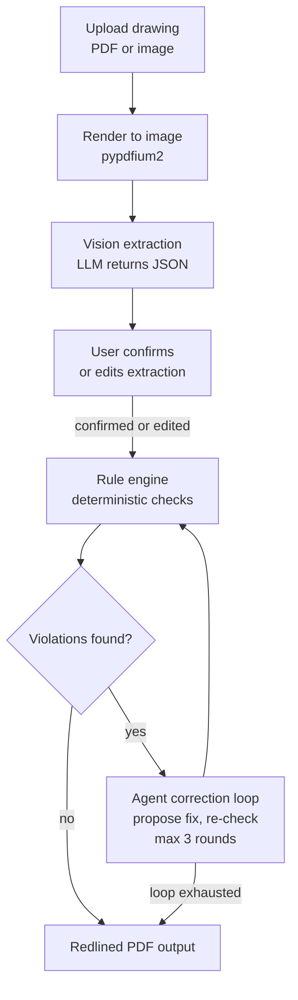

# DraftCheck — Architecture

Every item below is marked **BUILT** (exists in this repo today) or **PLANNED** (designed,
not yet written).

Last updated: 2026-10-29

## 1. Overview

DraftCheck reads an engineering drawing (PDF or image) and extracts its dimensions, GD&T
callouts, notes, and title-block data into structured JSON. It then checks that data
against a rule set covering dimensioning, GD&T, and manufacturability, and proposes a
correction for every violation it finds. The result is a redlined PDF showing each error
and the suggested fix.

## 2. Core principle

**The LLM reads and reasons; deterministic Python decides pass/fail.**

The model is used only for perception and explanation — turning pixels into structured
facts, and turning a rule violation into wording a person can act on. Whether a rule
passes is always computed in plain Python from the extracted data, so the same drawing
always produces the same verdicts. No rule outcome is ever read out of a model response.

## 3. Pipeline — PARTLY BUILT

Render, Extract, and Check work today; the stages between and after them are still planned.



Stage notes:

| Stage | What happens | Status |
| --- | --- | --- |
| Render | PDF page rasterized to an image the model can see, via `render.load_pages` | **BUILT** |
| Extract | Model returns a JSON object; parsed by `llm_parsing.extract_json`. Runs today via `scripts/extract_spike.py`; not yet wired into an app | **BUILT** |
| Confirm | User reviews and edits the extracted values before any checking | PLANNED |
| Check | Python rules produce pass/fail per rule, with no model involvement, via `rules.run_rules` | **BUILT** |
| Correct | Agent proposes a fix, rules re-run to verify it; **max 3 rounds**, then stop | PLANNED |
| Output | Annotated PDF with redline markup and a findings list | PLANNED |

The 3-round cap is a hard stop: if a proposed correction still fails, the finding is
reported unresolved rather than retried indefinitely.

## 4. Components

| Module | Role | Status |
| --- | --- | --- |
| `draftcheck/llm_parsing.py` | Pulls a single JSON object out of model output; strips `<think>` blocks and code fences; raises `JSONParseError` with the raw text attached | **BUILT** |
| `draftcheck/config.py` | Locates `.env` with `find_dotenv` and builds a frozen `Provider` (name, base_url, model, api_key); raises `ConfigError` naming any missing variable, and masks the key in `repr` | **BUILT** |
| `draftcheck/llm_client.py` | `LLMClient.chat(system, user)` over the OpenAI-compatible Baseten endpoint at `temperature=0`; `chat_json(system, user, images)` additionally sends PNG pages as `image_url` data URIs, parses the reply with `extract_json`, and retries once on `JSONParseError`. Both return latency, token usage, and model id | **BUILT** |
| `draftcheck/render.py` | `load_pages(path, dpi, max_side)` rasterizes a PDF with pypdfium2 or loads a PNG/JPG with pillow; returns `PageImage` (PNG bytes, width, height) per page, scaled down to `max_side` | **BUILT** |
| `draftcheck/prompts.py` | `EXTRACTION_SYSTEM` and `EXTRACTION_USER`: the model is a transcription engine that reports what is printed and never invents or repairs a callout; the user prompt fixes the JSON key set and the field rules. Correction wording still to come | **BUILT** |
| `draftcheck/schema.py` | pydantic v2 models for the extracted drawing (`Drawing`, `Dimension`, `FCF`, `DatumFeature`, `DatumRef`, `TitleBlock`, `GeneralTolerance`) and for rule output (`Finding`); `Units` and the 14-value `Characteristic` enum, plus `FORM_CONTROLS`. `parse_drawing(data)` validates a raw extraction dict: unknown keys are ignored, missing ids become `D1…`/`F1…`, and any item it cannot read is dropped into `Drawing.parse_issues` | **BUILT** |
| `draftcheck/rules.py` | `Rule` dataclass (id, title, category, severity, `source`, `check`), the `RULES` registry, and `run_rules(drawing)`. Five rules today — see §4.1. Output is sorted by rule id then item ids, so the same drawing always gives the same list | **BUILT** |
| `draftcheck/agent.py` | Correction loop: propose, re-check, stop at 3 rounds | PLANNED |
| `draftcheck/redline.py` | Overlays markup on the original PDF; library to be chosen in Layer 2 | PLANNED |
| `draftcheck/api.py` | FastAPI app: upload, confirm, results endpoints | PLANNED |
| `frontend/` | Upload page, extraction review/edit screen, findings view | PLANNED |
| `scripts/make_sample_drawing.py` | Generates a synthetic drawing (reportlab) with its ground-truth JSON and a PNG preview; seeds a known error so the rule engine has something to catch. The ground truth is written in `schema.py`'s field names — plus `bbox_convention` and `seeded_errors` — so it parses as a `Drawing` and doubles as the target an extraction is scored against | **BUILT** |
| `scripts/smoke_test.py` | One-shot check that the configured model answers over the network | **BUILT** |
| `scripts/extract_spike.py` | One extraction pass on a drawing: renders it, calls `chat_json`, and writes `outputs/spike/<name>.raw.txt`, `.json`, and `.overlay.png` (red boxes = model bboxes, green = ground truth from `--gt`). A look-at-it tool; it decides nothing | **BUILT** |

Rule text is always written in our own words with a `source` citation — no standards text
is copied into the code.

### 4.1 Rules in `rules.py` — BUILT

| Id | Title | Category | Severity | What it catches |
| --- | --- | --- | --- | --- |
| GDT-001 | Undefined datum | gdt | error | A feature control frame cites a datum letter that no datum feature symbol on the drawing defines, so the tolerance cannot be measured. One finding per frame per missing letter |
| GDT-002 | Duplicate datum | gdt | error | The same datum letter is defined more than once, so two features both claim it and an inspector cannot tell which to measure from |
| GDT-003 | Form control with datum | gdt | error | A control in `FORM_CONTROLS` (flatness, straightness, circularity, cylindricity) carries datum references. A form control describes one feature's own shape, so a datum on it has no meaning |
| GDT-004 | Position without basic dimensions | gdt | error | The drawing has a position tolerance but no basic dimensions anywhere, so no true location is established. **Drawing-level, not per-feature** — see the limitation below |
| DIM-001 | Missing units or general tolerance | dimensioning | error | Units are absent; and/or there is no general tolerance while some dimension carries none of its own and is neither basic nor reference, leaving it with no permitted range. Reports the two problems as separate findings |

Every finding names the offending item's id(s) and its bounding box, so the redline stage
can draw it in the right place. Datum feature symbols have no id of their own in the
schema, so GDT-002 refers to them positionally as `datum[0]`, `datum[1]`, …

Known limitation — GDT-004 only asks whether the drawing has any basic dimensions at all.
It cannot yet tell whether the basic dimensions present actually locate the feature a given
position frame applies to; that needs the `from_ref`/`to_ref` links, which extraction does
not fill in reliably today.

## 5. Repo layout (what exists today)

```
draftCheck/
├── .github/
│   └── workflows/
│       └── ci.yml              # ruff + pytest on push to main and on PRs
├── docs/
│   └── ARCHITECTURE.md         # this file
├── draftcheck/
│   ├── __init__.py
│   ├── config.py               # BUILT
│   ├── llm_client.py           # BUILT
│   ├── llm_parsing.py          # BUILT
│   ├── prompts.py              # BUILT
│   ├── render.py               # BUILT
│   ├── rules.py                # BUILT
│   └── schema.py               # BUILT
├── samples/
│   └── generated/              # synthetic drawings, regenerable from scripts/
│       ├── plate_001.pdf       # the drawing
│       ├── plate_001.gt.json   # ground truth in schema.py field names, parses as a Drawing
│       └── plate_001.png       # rendered preview
├── outputs/                    # git-ignored; spike dumps, overlays, redlined PDFs
├── scripts/
│   ├── __init__.py
│   ├── extract_spike.py        # python -m scripts.extract_spike <drawing> [--gt ...]
│   ├── make_sample_drawing.py  # python -m scripts.make_sample_drawing
│   └── smoke_test.py           # python -m scripts.smoke_test
├── tests/
│   ├── fixtures/               # frozen inputs the tests parse
│   │   └── plate_001.model.json  # real extraction output from the 2026-10-28 spike run
│   ├── test_config.py
│   ├── test_llm_client.py
│   ├── test_llm_parsing.py
│   ├── test_render.py
│   ├── test_rules.py
│   ├── test_sample_drawing.py
│   └── test_schema.py
├── CLAUDE.md                   # working rules for Claude Code
├── LICENSE                     # MIT
├── README.md
├── pyproject.toml
└── requirements.txt
```

## 6. Development workflow — BUILT

1. Claude Code works on a feature branch inside a git worktree, one step at a time.
2. Aakruti reviews the change and does all git operations — Claude Code never commits,
   pushes, merges, or rebases.
3. The branch goes up as a pull request against `main`.
4. CI runs `ruff check .` and `pytest`; both must pass.
5. Branch protection on `main` requires passing CI. No review is required, since this is
   a solo project.

## 7. Decisions log

| Date | Decision | Reason |
| --- | --- | --- |
| 2026-10-27 | Muse Spark Open on Baseten as the primary model | Credits available, and it makes the project eligible for the open-weight bonus prize |
| 2026-10-27 | MIT license | Hackathon rules require a public repo; MIT makes it genuinely open source |
| 2026-10-28 | pypdfium2 to render PDFs to images; reportlab to generate synthetic test drawings | Permissive licenses; testable locally without external services |
| 2026-10-28 | Branch protection with required CI and no required review | Solo developer, so CI is the gate instead of a reviewer |
| 2026-10-28 | `.env` lives at the repo root; config uses `find_dotenv` to locate it from any worktree | One secret file, never committed, works from the main folder and Claude Code worktrees |
| 2026-10-28 | Extraction spike passed on plate_001: 6/6 dimensions, FCF correct, seeded undefined-datum error preserved | Confirms Muse Spark Open transcribes faithfully; proceed with schema and rule engine |
| 2026-10-29 | Rules are a registry of `Rule` dataclasses, and `run_rules` sorts its output by rule id then item ids | A fixed order means two runs over the same drawing are directly comparable, which is what the correction loop needs to tell whether a proposed fix actually cleared a finding |
| 2026-10-29 | Lenient parsing: bad bboxes become None, unknown units become None, and an item that cannot be read at all is dropped and recorded in `Drawing.parse_issues` instead of failing the parse | Model output is imperfect; the user confirms data in the UI, and rules flag missing values instead of crashing. One unreadable callout must not cost us the rest of the drawing, and `parse_issues` keeps the loss visible rather than silent |

## 8. Status

| Layer | What it covers | State |
| --- | --- | --- |
| 1 | Extraction + JSON schema + rule engine + test generator | BUILT: JSON parser, config, LLM client, renderer, extraction prompts, sample-drawing generator, extraction spike, `schema.py`, `rules.py` with 5 rules. More rules can be added to the registry as the sample set grows |
| 2 | Agent correction loop + redlined PDF | PLANNED |
| 3 | Web UI + live deploy | PLANNED |
| 4 | After hackathon: SAM 3.1 precision, revisions, link to Research Paper Recommender | PLANNED (post-hackathon) |
