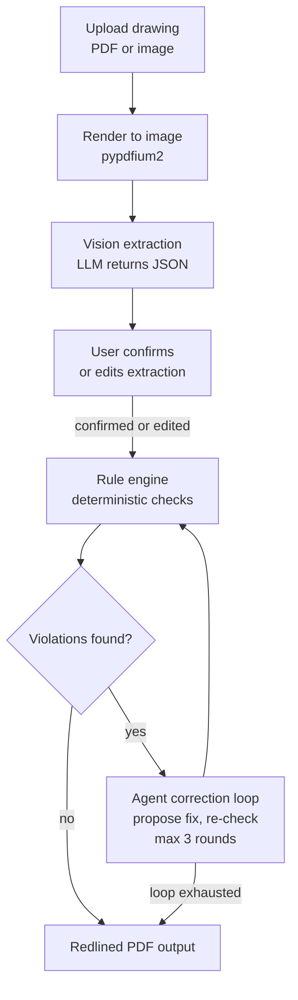

# DraftCheck — Architecture

Every item below is marked **BUILT** (exists in this repo today) or **PLANNED** (designed,
not yet written).

Last updated: 2026-10-28

## 1. Overview

DraftCheck reads an engineering drawing (PDF or image) and extracts its dimensions, GD&T
callouts, notes, and title-block data into structured JSON. It then checks that data
against a rule set covering dimensioning, GD&T, and manufacturability, and proposes a
correction for every violation it finds. The result is a redlined PDF showing each error
and the suggested fix.

## 2. Core principle

**The LLM reads and reasons; deterministic Python decides pass/fail.**

The model is used only for perception and explanation — turning pixels into structured
facts, and turning a rule violation into wording a person can act on. Whether a rule
passes is always computed in plain Python from the extracted data, so the same drawing
always produces the same verdicts. No rule outcome is ever read out of a model response.

## 3. Pipeline — PLANNED



Stage notes:

| Stage | What happens | Status |
| --- | --- | --- |
| Render | PDF page rasterized to an image the model can see | PLANNED |
| Extract | Model returns a JSON object; parsed by `llm_parsing.extract_json` | PLANNED (parser BUILT) |
| Confirm | User reviews and edits the extracted values before any checking | PLANNED |
| Check | Python rules produce pass/fail per rule, with no model involvement | PLANNED |
| Correct | Agent proposes a fix, rules re-run to verify it; **max 3 rounds**, then stop | PLANNED |
| Output | Annotated PDF with redline markup and a findings list | PLANNED |

The 3-round cap is a hard stop: if a proposed correction still fails, the finding is
reported unresolved rather than retried indefinitely.

## 4. Components

| Module | Role | Status |
| --- | --- | --- |
| `draftcheck/llm_parsing.py` | Pulls a single JSON object out of model output; strips `<think>` blocks and code fences; raises `JSONParseError` with the raw text attached | **BUILT** |
| `draftcheck/config.py` | Loads settings and secrets from `.env` via python-dotenv; no secrets in code | PLANNED |
| `draftcheck/llm_client.py` | Thin wrapper over the OpenAI-compatible Baseten endpoint; retries and timeouts | PLANNED |
| `draftcheck/render.py` | PDF/image to raster pages via pypdfium2 + pillow | PLANNED |
| `draftcheck/prompts.py` | Prompt text for extraction and for correction wording | PLANNED |
| `draftcheck/schema.py` | pydantic models for the extracted drawing, findings, and corrections | PLANNED |
| `draftcheck/rules.py` | Deterministic rule functions; each carries a `source` field citing the reference | PLANNED |
| `draftcheck/agent.py` | Correction loop: propose, re-check, stop at 3 rounds | PLANNED |
| `draftcheck/redline.py` | Overlays markup on the original PDF; library to be chosen in Layer 2 | PLANNED |
| `draftcheck/api.py` | FastAPI app: upload, confirm, results endpoints | PLANNED |
| `frontend/` | Upload page, extraction review/edit screen, findings view | PLANNED |

Rule text is always written in our own words with a `source` citation — no standards text
is copied into the code.

## 5. Repo layout (what exists today)

```
draftCheck/
├── .github/
│   └── workflows/
│       └── ci.yml              # ruff + pytest on push to main and on PRs
├── docs/
│   └── ARCHITECTURE.md         # this file
├── draftcheck/
│   ├── __init__.py
│   └── llm_parsing.py          # BUILT
├── tests/
│   └── test_llm_parsing.py
├── CLAUDE.md                   # working rules for Claude Code
├── LICENSE                     # MIT
├── README.md
├── pyproject.toml
└── requirements.txt
```

## 6. Development workflow — BUILT

1. Claude Code works on a feature branch inside a git worktree, one step at a time.
2. Aakruti reviews the change and does all git operations — Claude Code never commits,
   pushes, merges, or rebases.
3. The branch goes up as a pull request against `main`.
4. CI runs `ruff check .` and `pytest`; both must pass.
5. Branch protection on `main` requires passing CI. No review is required, since this is
   a solo project.

## 7. Decisions log

| Date | Decision | Reason |
| --- | --- | --- |
| 2026-10-27 | Muse Spark Open on Baseten as the primary model | Credits available, and it makes the project eligible for the open-weight bonus prize |
| 2026-10-27 | MIT license | Hackathon rules require a public repo; MIT makes it genuinely open source |
| 2026-10-28 | pypdfium2 to render PDFs to images; reportlab to generate synthetic test drawings | Permissive licenses; testable locally without external services |
| 2026-10-28 | Branch protection with required CI and no required review | Solo developer, so CI is the gate instead of a reviewer |

## 8. Status

| Layer | What it covers | State |
| --- | --- | --- |
| 1 | Extraction + JSON schema + rule engine + test generator | IN PROGRESS — `llm_parsing.py` BUILT, rest PLANNED |
| 2 | Agent correction loop + redlined PDF | PLANNED |
| 3 | Web UI + live deploy | PLANNED |
| 4 | After hackathon: SAM 3.1 precision, revisions, link to Research Paper Recommender | PLANNED (post-hackathon) |
