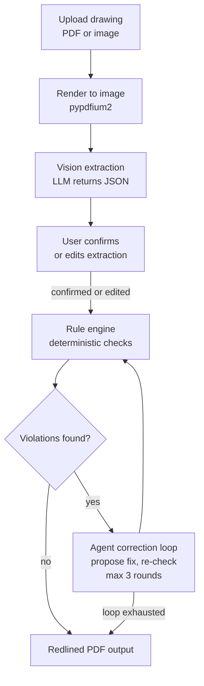

# DraftCheck — Architecture

Every item below is marked **BUILT** (exists in this repo today) or **PLANNED** (designed,
not yet written).

Last updated: 2026-10-30

## 1. Overview

DraftCheck reads an engineering drawing (PDF or image) and extracts its dimensions, GD&T
callouts, notes, and title-block data into structured JSON. It then checks that data
against a rule set covering dimensioning, GD&T, and manufacturability, and proposes a
correction for every violation it finds. The result is a redlined PDF showing each error
and the suggested fix.

## 2. Core principle

**The LLM reads and reasons; deterministic Python decides pass/fail.**

The model is used only for perception and explanation — turning pixels into structured
facts, and turning a rule violation into wording a person can act on. Whether a rule
passes is always computed in plain Python from the extracted data, so the same drawing
always produces the same verdicts. No rule outcome is ever read out of a model response.

## 3. Pipeline — PARTLY BUILT

Render, Extract, Check, Correct, and the redlined PDF output work today. The
user-confirmation step is still planned.



Stage notes:

| Stage | What happens | Status |
| --- | --- | --- |
| Render | PDF page rasterized to an image the model can see, via `render.load_pages` | **BUILT** |
| Extract | Model returns a JSON object; parsed by `llm_parsing.extract_json`, then validated by `schema.parse_drawing`. Wired up as `pipeline.extract` | **BUILT** |
| Confirm | User reviews and edits the extracted values before any checking. Over HTTP today: the extraction goes back from `POST /api/runs` and the (possibly edited) data comes in to `POST /api/runs/{id}/check`. The browser screen itself is the next step | **PARTLY BUILT** (API only) |
| Check | Python rules produce pass/fail per rule, with no model involvement, via `rules.run_rules`, wrapped as `pipeline.check` | **BUILT** |
| Correct | Agent proposes edits from a fixed menu, Python applies the safe ones and re-runs the rules to verify; **max 3 rounds**, then stop. `agent.correct`, see §4.5 | **BUILT** |
| Output | Two-page redline: the drawing with a numbered marker per located finding, and a findings page behind it. `redline.render_redline` / `redline.save_redline`, see §4.7 | **BUILT** |

Render → Extract → Check → Correct runs end to end today from one command,
`python -m draftcheck.cli check --fix` — see §4.3.

The 3-round cap is a hard stop: if a proposed correction still fails, the finding is
reported unresolved rather than retried indefinitely.

## 4. Components

| Module | Role | Status |
| --- | --- | --- |
| `draftcheck/llm_parsing.py` | Pulls a single JSON object out of model output; strips `<think>` blocks and code fences; raises `JSONParseError` with the raw text attached | **BUILT** |
| `draftcheck/config.py` | Locates `.env` with `find_dotenv` and builds a frozen `Provider` (name, base_url, model, api_key) for one of the providers in `PROVIDER_ENV_VARS` — see §4.4; raises `ConfigError` naming any missing variable, and masks the key in `repr` | **BUILT** |
| `draftcheck/llm_client.py` | `LLMClient.chat(system, user)` over the configured provider's OpenAI-compatible endpoint at `temperature=0`; `chat_json(system, user, images)` additionally sends PNG pages as `image_url` data URIs, parses the reply with `extract_json`, and retries once on `JSONParseError`. Both return latency, token usage, and model id | **BUILT** |
| `draftcheck/render.py` | `load_pages(path, dpi, max_side)` rasterizes a PDF with pypdfium2 or loads a PNG/JPG with pillow; returns `PageImage` (PNG bytes, width, height) per page, scaled down to `max_side`. **`RenderError` is the only error it raises**: pypdfium2's `PdfiumError` and pillow's `UnidentifiedImageError` are both translated, so a file named `.pdf` that is not one becomes the CLI's exit 2 and the API's 400 rather than a traceback | **BUILT** |
| `draftcheck/prompts.py` | `EXTRACTION_SYSTEM` and `EXTRACTION_USER`: the model is a transcription engine that reports what is printed and never invents or repairs a callout; the user prompt fixes the JSON key set and the field rules, including each dimension's `from_ref`/`to_ref` endpoints (§4.2). `CORRECTION_SYSTEM` and `correction_user(drawing_json, findings, history)`: the model is a drawing checker proposing the smallest edits that preserve design intent, one rationale sentence each, citing the finding ids it addresses. The operation catalogue in the user prompt is generated from `edits.ALLOWED_OPS` and `edits.DIMENSION_FIELDS`, so it cannot drift from what the code accepts | **BUILT** |
| `draftcheck/schema.py` | pydantic v2 models for the extracted drawing (`Drawing`, `Dimension`, `FCF`, `DatumFeature`, `DatumRef`, `TitleBlock`, `GeneralTolerance`) and for rule output (`Finding`); `Units` and the 14-value `Characteristic` enum, plus `FORM_CONTROLS`. `parse_drawing(data)` validates a raw extraction dict: unknown keys are ignored, missing ids become `DT1…`/`D1…`/`F1…` (datums, dimensions, frames), and any item it cannot read is dropped into `Drawing.parse_issues`. `finding_key(finding)` names one finding as `<rule id>@<item ids>`, which is how rounds are compared and how the model cites a finding. `DatumFeature.location` is an optional plain-words description of where a symbol belongs: extraction leaves it empty, since a transcribed symbol already has a `bbox`, and the correction loop fills it in when it proposes a datum that is not on the sheet yet | **BUILT** |
| `draftcheck/rules.py` | `Rule` dataclass (id, title, category, severity, `source`, `check`), the `RULES` registry, and `run_rules(drawing)`. Six rules today — see §4.1. Output is sorted by rule id then item ids, so the same drawing always gives the same list | **BUILT** |
| `draftcheck/pipeline.py` | The two stages of one run, with no printing and no argument parsing, so the CLI and later the API can both drive them. `extract(path, client, dpi)` renders **page 1 only**, calls `chat_json` with the extraction prompts, and validates the reply with `parse_drawing`; it returns an `ExtractionResult` (the `Drawing` plus raw reply text, latency, model id, token usage, attempts). `check(drawing)` wraps `run_rules` | **BUILT** |
| `draftcheck/cli.py` | The `check` subcommand — see §4.3. Writes the run's files, prints the findings table and any `parse_issues`, and sets the exit code | **BUILT** |
| `draftcheck/edits.py` | The four operations the agent may propose — `set_field`, `add_datum`, `remove_datum_ref`, `add_dimension` — as pydantic models, plus `apply_edits(drawing, edits)` returning `(new_drawing, applied, rejected)`. Applies one edit at a time to a copy, re-validating the whole drawing after each, and refuses anything that deletes a feature, touches a protected field, names an unknown id, uses an unknown operation, or silently fails to take. Never raises on bad model output — see §4.6 | **BUILT** |
| `draftcheck/agent.py` | `correct(drawing, image_png, client, max_rounds=3)` → `CorrectionReport`. One round = ask, apply, re-run `rules.run_rules`, diff the findings. Records `proposed`, `applied`, `rejected`, findings before and after, `resolved`, and `introduced` per round, and a resolved/unresolved verdict per original finding — all computed from the re-run, never from the model's claim. Stops when no error-severity finding is left or after `max_rounds` — see §4.5 | **BUILT** |
| `draftcheck/redline.py` | `render_redline(page_png, findings, report=None, model_name=None, when=None)` → two pillow pages, and `save_redline(pages, path_pdf, path_png)` → a 2-page PDF plus page 1 as a PNG. Pillow only, drawn on the rendered page image. Markers are numbered in `run_rules` order, so a number means the same finding on page 1, on page 2, and in `findings.json`. `findings_text(findings, report)` returns page 2's wording as styled lines, so the text can be tested without reading pixels — see §4.7 | **BUILT** |
| `draftcheck/api.py` | FastAPI app over the same four modules the CLI drives: upload + extract, check the confirmed data, run the correction loop, serve the page image and the redline. One run is one folder under `outputs/web/<uuid4>/`, so each request reads what the previous one wrote — see §4.8. Decides nothing itself | **BUILT** |
| `draftcheck/static/` | The browser page, served at `/`: `index.html`, `style.css`, `app.js`. Plain HTML, CSS, and JavaScript — no framework, no build step, nothing loaded from a CDN. Today the upload area is a drag-and-drop zone (click, Enter, or Space opens the file dialog; a dropped file starts reading at once) that rejects a wrong type or a file over 10 MB in the page before any request, beside the provider selector. It uploads the drawing (`POST /api/runs`) and shows what came back: the rendered page beside read-only tables of units, datums, dimensions, and frames, plus model, latency, and any `parse_issues`. The tables and the drawing are linked by item id: every item with a `bbox` gets a faint box drawn over the page image (positioned in percentages, so it stays aligned at any size), hovering a row or a box lights both, and clicking either scrolls the other into view and keeps it lit until the next click. A "Show what Muse Spark read" toggle, on by default, hides the boxes; a row whose item came back without a `bbox` is marked "no location" and is not interactive. Tables are built with `textContent`, so model output is never treated as markup | **BUILT** (upload + view + linked highlighting) |
| `frontend/` | Editing the extraction in the browser, then driving `/check` and `/fix` from the page and showing the findings and the redline | PLANNED |
| `scripts/make_sample_drawing.py` | Generates a synthetic drawing (reportlab) with its ground-truth JSON and a PNG preview; seeds a known error so the rule engine has something to catch. The ground truth is written in `schema.py`'s field names — plus `bbox_convention` and `seeded_errors` — so it parses as a `Drawing` and doubles as the target an extraction is scored against | **BUILT** |
| `scripts/smoke_test.py` | One-shot check that the configured model answers over the network; `--provider baseten\|meta` picks which one | **BUILT** |
| `scripts/extract_spike.py` | One extraction pass on a drawing: renders it, calls `chat_json`, and writes `outputs/spike/<name>.raw.txt`, `.json`, and `.overlay.png` (red boxes = model bboxes, green = ground truth from `--gt`). A look-at-it tool; it decides nothing | **BUILT** |

Rule text is always written in our own words with a `source` citation — no standards text
is copied into the code.

### 4.1 Rules in `rules.py` — BUILT

| Id | Title | Category | Severity | What it catches |
| --- | --- | --- | --- | --- |
| GDT-001 | Undefined datum | gdt | error | A feature control frame cites a datum letter that no datum feature symbol on the drawing defines, so the tolerance cannot be measured. One finding per frame per missing letter |
| GDT-002 | Duplicate datum | gdt | error | The same datum letter is defined more than once, so two features both claim it and an inspector cannot tell which to measure from |
| GDT-003 | Form control with datum | gdt | error | A control in `FORM_CONTROLS` (flatness, straightness, circularity, cylindricity) carries datum references. A form control describes one feature's own shape, so a datum on it has no meaning |
| GDT-004 | Position without basic dimensions | gdt | error | The drawing has a position tolerance but no basic dimensions anywhere, so no true location is established. **Drawing-level, not per-feature** — see the limitation below |
| DIM-001 | Missing units or general tolerance | dimensioning | error | Units are absent; and/or there is no general tolerance while some dimension carries none of its own and is neither basic nor reference, leaving it with no permitted range. Reports the two problems as separate findings |
| MFG-001 | Hole too close to edge | manufacturability | warning | A hole leaves less solid material between its wall and a part edge than `MIN_EDGE_MATERIAL_RATIO` × the hole diameter (1.0 today), so the web can tear out or bulge when the hole is drilled or punched. One finding per hole per failing edge |

Every finding names the offending item's id(s) and its bounding box, so the redline stage
can draw it in the right place.

#### MFG-001 — how the distance is worked out

The rule reads geometry out of each dimension's `from_ref`/`to_ref` pair (see §4.2):

- **Hole diameter** comes from a dimension whose `feature_type` is `diameter`. With more
  than one, the largest is used — a bigger hole leaves less material, so that is the
  conservative read. With none, the rule computes nothing and stays silent.
- **Material left** for a dimension running from an edge to `hole_N_center` is
  `value − diameter / 2`, i.e. the hole's wall, not its centre, to the edge.
- **The facing edge** is usually not dimensioned. When an overall size spans the part
  (`left_edge`→`right_edge`, or `bottom_edge`→`top_edge`), the distance to the opposite
  edge is derived as `overall − value`. A printed distance always wins over a derived one
  for the same hole and edge. A derived finding names both dimensions it used.

The threshold is a default, not a standard: `MIN_EDGE_MATERIAL_RATIO` in `rules.py` is
meant to be tuned per process and material.

Known limitation — GDT-004 only asks whether the drawing has any basic dimensions at all.
It cannot yet tell whether the basic dimensions present actually locate the feature a given
position frame applies to; that needs per-feature use of the `from_ref`/`to_ref` links.

### 4.2 Dimension endpoints: `from_ref` and `to_ref` — BUILT

A dimension's value alone is just a number. `from_ref` and `to_ref` say what it measures
between, which is what turns "20" into "the left edge to hole 1's centre" — the fact
MFG-001 needs. Extraction asks for one of: `left_edge`, `right_edge`, `top_edge`,
`bottom_edge`, `hole_N_center` (holes numbered left to right, then top to bottom),
`datum_X`, or `null` when the model cannot tell.

When a dimension lands on a physical edge the prompt asks for the edge name even if that
edge also carries a datum feature symbol — the rule needs geometry, and on plate_001 the
left edge is also datum B. Both fields stay optional in the schema: a drawing with no
endpoint information parses fine, and MFG-001 simply has nothing to check.

On the 2026-10-29 spike run the model filled all six of plate_001's dimensions correctly,
including both overall sizes and both hole locations.

### 4.3 The `check` command — BUILT

```
python -m draftcheck.cli check <drawing> [--from-json path] [--provider baseten|meta]
                                         [--fix] [--redline] [--out dir] [--dpi n]
```

`--fix` runs the correction loop after the check (§4.5) and prints, per round, what was
proposed, what was applied with its rationale, what was rejected and why, and which
findings cleared or appeared — then a status table of the findings the drawing started
with. It calls the model even under `--from-json`, because the saved extraction only
covers the check.

`--fix` does **not** change the exit code, which always describes the drawing as
submitted. A drawing whose errors the loop resolved still exits `1`, and the run says so
on its last line:

```
Agent proposals are unreviewed; original drawing has 1 error(s).
```

`--redline` writes `redline.pdf` and `redline.png` to the output folder (§4.7). It works
with or without `--fix`; with `--fix` the findings page also carries each applied edit, its
rationale, and the rule engine's verdict on whether the finding cleared.

`--provider` chooses the model to call (§4.4); with no flag it follows `LLM_PROVIDER` in
`.env`. The run prints the provider and the model id before calling.

`--from-json` loads a saved extraction instead of calling the model, which makes a run
free, offline, and repeatable; it is how the CLI tests exercise the whole command. The
drawing is still rendered in that mode, so a bad path fails loudly rather than appearing
to pass on a saved extraction.

Each run writes to `--out`, defaulting to `outputs/runs/<drawing-name>/`:

| File | Contents |
| --- | --- |
| `extraction.json` | The validated `Drawing`, including `parse_issues` |
| `findings.json` | The findings list, in `run_rules` order |
| `raw.txt` | The model's reply exactly as received. **Only written when the model ran** |
| `corrections.json` | Every round (proposed, applied, rejected with reasons, findings before and after, resolved, introduced), the per-finding status, the final findings, and the corrected drawing. **Only written with `--fix`** |
| `redline.pdf` | The two-page redline: marked drawing, then the findings page. **Only written with `--redline`** |
| `redline.png` | Page 1 of the redline on its own, for embedding in a README or a demo. **Only written with `--redline`** |

Exit codes are meant for CI: `0` clean, `1` at least one error-severity finding, `2` the
run could not happen at all (unreadable drawing, bad JSON, missing config, model failure).
A warning-only run still exits `0`.

A real run on 2026-10-29, against `meta-models/muse-spark-open-1026`:

```
$ python -m draftcheck.cli check samples/generated/plate_001.pdf
Drawing:  samples/generated/plate_001.pdf
Provider: baseten
Model:    meta-models/muse-spark-open-1026
Calling the model...
Latency:  24.70s  (attempts: 1)

RULE     SEVERITY  ITEMS  MESSAGE
GDT-001  error     fcf_1  Feature control frame fcf_1 references datum C, but no datum
                          feature symbol on the drawing defines C. ...

1 error(s), 0 warning(s).
Wrote extraction.json, findings.json, raw.txt to outputs/runs/plate_001/
```

That is the error seeded into plate_001 by `scripts/make_sample_drawing.py`, found end to
end from the PDF with no hand-edited input — the first full Render → Extract → Check pass.

### 4.4 Two providers — BUILT

Both endpoints are OpenAI-compatible, so one `LLMClient` serves both and nothing above
`config.py` knows which is in use. `PROVIDER_ENV_VARS` maps a provider name to the three
variables it needs; `get_provider(name)` takes the name as an argument, falling back to
`LLM_PROVIDER` and then to `baseten`. Only the chosen provider's variables are required, so
Meta runs do not need Baseten configured.

| Provider | Model | Variables | Role |
| --- | --- | --- | --- |
| `baseten` | `meta-models/muse-spark-open-1026` | `BASETEN_BASE_URL`, `BASETEN_MODEL`, `BASETEN_API_KEY` | **Default.** Open-weight, keeps us eligible for the open-weight bonus prize |
| `meta` | `muse-spark-1.2` (standard tier) | `META_BASE_URL`, `META_MODEL`, `META_API_KEY` | Comparison model via the Meta Model API |

#### Comparison on plate_001 — 2026-10-29

Same drawing, same prompts, same 200 DPI render; one run each.

| | Baseten (muse-spark-open-1026) | Meta (muse-spark-1.2) |
| --- | --- | --- |
| Latency | 17.49 s | 11.44 s |
| Attempts to valid JSON | 1 | 1 |
| Dimensions found | 6 / 6 | 6 / 6 |
| Dimension values | all correct | identical to Baseten |
| `from_ref` / `to_ref` | 5 of 6 filled, Ø8 left null | identical to Baseten |
| Per-dimension tolerances | none printed, none invented | same |
| General tolerance + units | ±0.1, mm | same |
| FCF | 1: position 0.25 MMC, datums A\|B\|C | same |
| Datums defined | 2 (A, B) | same |
| Title block | all 5 fields correct | same |
| `parse_issues` | none | none |
| Findings | GDT-001 error on `fcf_1` | same |

Every field the rules read came out the same, so both models produce the same verdict on
this drawing. The only differences are bounding boxes and confidence values: Meta boxes the
dimension *text* tightly, while Baseten often boxes the whole dimension line plus its text
(for the 100 mm overall, `0.25–0.662` wide against Meta's `0.442–0.482`). That matters only
for redline placement, not for any rule today. One drawing is not an evaluation — this is a
baseline to widen as the sample set grows.

### 4.5 The correction loop — BUILT

`agent.correct(drawing, image_png, client, max_rounds=3)` returns a `CorrectionReport`.

One round:

1. Send the model the page image, the current drawing JSON (ids included), the current
   findings with their `finding_key` names, and the history of earlier rounds.
2. Take back `{"edits": [...]}` and hand it to `edits.apply_edits`, which applies what it
   allows to a copy and refuses the rest with a reason (§4.6).
3. Run `rules.run_rules` on the result.
4. Diff the finding keys before against after. What disappeared is `resolved`; what
   appeared is `introduced`.

The loop stops when no **error**-severity finding is left, or after `max_rounds`. Warnings
do not keep it running: MFG-001's edge-distance threshold is shop practice we chose
ourselves, and spending rounds on it would push the model into changing a part's geometry
to satisfy a number that is not a standard.

The report carries the final drawing, the final findings, one `RoundRecord` per round, and
a `resolved`/`unresolved` verdict for every finding the drawing started with.

**The model's account of its own work is never read.** Each edit carries `rationale` and
`finding_ids`; both go into the report for a person to read, and neither is used to mark
anything resolved. A finding is resolved when the re-run stops reporting it. A test asserts
exactly this: an edit that applies cleanly and claims the finding still leaves it
unresolved, because the rules still report it.

A round that fails outright — provider error, unusable reply — is recorded on the round
with its `error` and stops the loop, keeping whatever earlier rounds achieved.

#### A real run on plate_001 — 2026-10-29

```
$ python -m draftcheck.cli check samples/generated/plate_001.pdf --fix
...
RULE     SEVERITY  ITEMS  MESSAGE
GDT-001  error     fcf_1  Feature control frame fcf_1 references datum C, but no datum
                          feature symbol on the drawing defines C. ...

1 error(s), 0 warning(s).

Fixing with baseten / meta-models/muse-spark-open-1026...

=== Correction loop — 1 round(s) ===

Round 1: proposed 1, applied 1, rejected 0
  applied   remove_datum_ref  datum C from frame fcf_1
            why: The hole pattern is fully located in both directions by basic dimensions
                 20 and 80 from datum B and 30 from datum A, so the position tolerance is
                 completely defined and measurable with only the two existing orthogonal
                 datums.
            claims to address: GDT-001@fcf_1
  findings  1 before -> 0 after
  cleared   GDT-001@fcf_1

STATUS    RULE     FINDING        MESSAGE
resolved  GDT-001  GDT-001@fcf_1  Feature control frame fcf_1 references datum C, ...

1 resolved, 0 unresolved (decided by re-running the rules, not by the model).
Wrote extraction.json, findings.json, raw.txt, corrections.json to outputs/runs/plate_001/
Agent proposals are unreviewed; original drawing has 1 error(s).
$ echo $?
1
```

The model chose the right fix for the right reason — the two datums present do locate the
hole pattern, so the third reference is surplus rather than something to invent a feature
for — and `remove_datum_ref` is on the menu precisely so it can say that without deleting
the frame.

### 4.6 What the agent is allowed to edit — BUILT

The easiest way to clear a finding is to delete whatever caused it. Remove `fcf_1` and
"references undefined datum C" disappears, with the drawing strictly worse. So the model
does not edit the drawing; it proposes edits, and `edits.py` decides what happens.

| Operation | What it does |
| --- | --- |
| `set_field` | Change one whitelisted field of one dimension, frame, or datum by id, or the drawing's `units` / `general_tolerance` |
| `add_datum` | Add a datum feature symbol, with a label and a short location description in words (`bbox` optional) |
| `remove_datum_ref` | Take one datum letter out of one frame. The frame and the datum both survive |
| `add_dimension` | Add a dimension, given as the fields of a `Dimension` |

There is no delete operation. The guards, in the order they fire:

- **Unknown operation** — refused. If the name contains a deletion word (`remove`,
  `delete`, `drop`, …) the refusal says the rule out loud, so the next round's history
  tells the model why rather than just that.
- **Unknown or missing id**, and a malformed proposal — refused with the field at fault.
- **Protected fields** — `id` and `bbox` identify and locate an item, and `datum_refs` is a
  list that one assignment could empty, so it changes only through `remove_datum_ref`.
  `set_field` works off a whitelist per target, so nothing becomes editable by accident
  when the schema grows.
- **Invalid values** — the whole drawing is re-validated through `schema.parse_drawing`
  after every single edit. Anything that produces an item the schema cannot read is rolled
  back, and the edits around it still get their turn.
- **Silent no-ops** — parsing is deliberately lenient (§7), so a negative `tol_plus`
  becomes `None` rather than raising. That is right for extraction and wrong here: the edit
  would be reported as applied while changing nothing. Any request for a real value that
  comes back `None` is refused.
- **Anything that loses a feature** — a backstop that runs after every operation, whatever
  it claimed to do: an id present before the edit and missing after it is a rollback.

`apply_edits` never raises. A malformed proposal is information about the model, and it
goes back into the next round's prompt as a reason, which is what stops the same refused
edit being proposed three times running.

### 4.7 The redlined output — BUILT

`redline.render_redline(page_png, findings, report=None, model_name=None, when=None)`
returns two pillow images; `redline.save_redline(pages, path_pdf, path_png)` writes them as
a 2-page PDF (at 200 dpi, so the page comes out its real physical size) and page 1 on its
own as a PNG.

**Page 1** is the rendered drawing. Every finding that has a bounding box gets the mark a
checker would draw by hand: a red rectangle around the box, padded by 0.5% of the page
width and drawn 0.3% wide, with a numbered balloon — a filled red disc 3% of the page
width across, white number inside — just off the rectangle's top-right corner on a short
leader. The rectangle encloses rather than covers, so the callout under review stays
readable. If the balloon would hang off the sheet the other three corners are tried in
turn, and as a last resort it is clamped into the page, because a finding must never lose
its number. A stamp in the top-left corner gives the finding count, the model that ran,
and the date, separated by ` | `.

**Page 2** is a clean white sheet the same size: every finding by number, with its rule id,
severity, and message. With a `CorrectionReport` it also carries each applied edit, that
edit's rationale, and `verified resolved` or `unresolved`. The footer reads *Proposed
corrections are verified by DraftCheck's rule engine and require engineer review.*

Edits are written out in plain English — `Remove datum C from the position frame`, not
`remove_datum_ref datum C from frame fcf_1` — by `plain_edit(edit, names)`, which names a
frame by its characteristic and a dimension by what is printed on it. Item ids do not
appear on the page at all: the reader has the drawing in front of them and is deciding
whether a correction is right, and `fcf_1` tells them nothing. The ids stay in
`findings.json` and `corrections.json`, and `Edit.describe()` is left as it is so the
terminal output and `corrections.json` keep them. Items are named from the drawing as
**submitted**, so "the 20 dimension" is the one on the sheet rather than what an earlier
edit turned it into.

Two things are worth being explicit about:

- **Numbering is `run_rules` order.** Marker 3 on page 1, entry 3 on page 2, and the third
  object in `findings.json` are the same finding. Nothing re-sorts for presentation.
- **The verdict is still the rule engine's.** An edit's `finding_ids` is the model's own
  claim, and it is used only to decide which finding an edit is printed under.
  `verified resolved` comes from `CorrectionReport.statuses`, which `agent.correct`
  computes by re-running the rules (§4.5). The redline displays a decision; it never makes
  one.

A finding the rules could not place — DIM-001 is drawing-level, not tied to one callout —
has nothing to mark, so page 2 says `location not marked` under it. It is counted in the
stamp like any other.

Text is sized as a fraction of the page width — title 2.5%, body 1.6% — and wrapped to the
page, so the sheet is readable on screen at full width rather than only when zoomed in.

Pillow's bundled font covers Latin-1 and little else, and a missing glyph draws as a blank
box that reads as markup rather than as a font problem. `ascii_safe(text)` runs over every
string the page draws: it substitutes the typographic punctuation we might emit (em dash,
curly quotes, ellipsis) and keeps `±`, `Ø`, `×`, `°`, which carry engineering meaning and
which the font has.

`findings_text(findings, report)` returns page 2's content as styled `Line` objects before
anything is drawn, which is what lets the tests assert on the wording instead of inspecting
pixels.

### 4.8 The HTTP API — BUILT

`draftcheck/api.py`, run with `uvicorn draftcheck.api:app --port 8000`. It adds no logic:
extraction is `pipeline.extract`, the verdicts are `pipeline.check`, the loop is
`agent.correct`, and the redline is `redline.render_redline`. What it adds is the state the
CLI never needs — one run spread across several requests.

**A run is a folder.** `outputs/web/<uuid4>/` holds everything one drawing produces, and
each request reads what the previous one left behind. That makes "which step is this run
at" a fact on disk rather than something the server has to remember: `/check` needs the
folder, `/fix` needs `confirmed.json`, and a request arriving out of order is refused by
looking.

| Method | Path | Does | Errors |
| --- | --- | --- | --- |
| `POST` | `/api/runs` | Multipart upload of a PDF/PNG/JPG, plus an optional `provider` field. Creates the run folder, saves the file, renders page 1, and extracts. Returns `run_id`, the drawing, `parse_issues`, `model`, `latency_s` | `415` unsupported type, `413` over 10 MB, `400` unreadable or empty, `422` unknown provider, `502` the model failed or returned something unusable, `500` missing configuration |
| `GET` | `/api/runs/{run_id}/page.png` | The rendered page, for the review screen to draw on | `404` |
| `POST` | `/api/runs/{run_id}/check` | Body is the confirmed (possibly edited) drawing JSON. Validates it with `parse_drawing`, saves `confirmed.json`, runs the rules. Returns the findings, `parse_issues`, and the error/warning counts | `404` unknown run, `422` not a drawing object |
| `POST` | `/api/runs/{run_id}/fix` | Runs the correction loop on `confirmed.json` with the page image, writes `corrections.json` and the redline. Returns rounds (proposed/applied/rejected), the per-finding status, the final findings, and the corrected drawing | `404` unknown run, `409` `/check` has not run |
| `GET` | `/api/runs/{run_id}/redline.pdf` | The two-page redline | `404` |
| `GET` | `/api/runs/{run_id}/redline.png` | Page 1 of the redline | `404` |
| `GET` | `/` | Static files from `draftcheck/static/`, mounted last so every `/api` route wins | — |

Per run: `source.<ext>`, `page.png`, `extraction.json`, `raw.txt`, `meta.json` from the
upload; `confirmed.json` and `findings.json` from `/check`; `corrections.json`,
`redline.pdf`, and `redline.png` from `/fix`.

Four things are deliberate:

- **`run_id` is typed as a `UUID` in every path.** Anything else is rejected by FastAPI
  before the endpoint runs, so a run folder is always `root / <uuid>` and a path cannot be
  traversed out of. Unknown-but-well-formed ids are `404`; malformed ones are `422`.
- **The upload is streamed in 1 MB chunks and aborted past 10 MB.** A size limit whose
  check happens after the whole body is buffered is not a limit, and `Content-Length` is
  the client's claim rather than a measurement. A refused upload removes its own folder.
- **The LLM client arrives through a dependency** (`get_client_factory`) that returns a
  *factory*, since the provider is chosen per request. Tests override that one function,
  and no test anywhere reaches the network.
- **No key is returned or logged.** `meta.json` carries the provider *name*, the model id,
  and the latency. `config.Provider` already masks the key in `repr`.

`/check` can be called again with different data — the second confirmation replaces the
first, so `/fix` always works from what the user last confirmed.

#### A real run on plate_001 — 2026-10-30

Server up, three curl calls, trimmed:

```
$ curl -s -X POST http://127.0.0.1:8000/api/runs -F "file=@samples/generated/plate_001.pdf"
run_id   1a089cfd-9f81-4a93-b063-cf43b8dd1cf7
model    meta-models/muse-spark-open-1026
latency  17.68 s      parse_issues []
datums   ['A', 'B']
dims     ['80', '20', '60 ±0.2', '100 ±0.2', '30', '2X Ø8 ±0.1']
fcf      position 0.25 ['A', 'B', 'C']

$ curl -s -X POST .../check -H 'Content-Type: application/json' --data @drawing.json
errors 1  warnings 0  parse_issues []
  GDT-001 error ['fcf_1'] Feature control frame fcf_1 references datum C, but no datum...

$ curl -s -X POST .../fix
rounds 1  applied 1  rejected 0  resolved 1  unresolved 0
  applied  remove_datum_ref  datum C from frame fcf_1
   why: The two orthogonal edge datums A and B already fully locate the hole pattern...
  cleared  ['GDT-001@fcf_1']  new []
status   resolved GDT-001@fcf_1

$ curl -s -o redline.pdf -w '%{http_code} %{content_type} %{size_download}' .../redline.pdf
200 application/pdf 307707
```

Same drawing, same model, and the same correction the CLI gets — over HTTP, with the data
passing through a client in between.

## 5. Repo layout (what exists today)

```
draftCheck/
├── .github/
│   └── workflows/
│       └── ci.yml              # ruff + pytest on push to main and on PRs
├── docs/
│   └── ARCHITECTURE.md         # this file
├── draftcheck/
│   ├── __init__.py
│   ├── agent.py                # BUILT  correction loop, max 3 rounds
│   ├── cli.py                  # BUILT  python -m draftcheck.cli check <drawing> [--fix]
│   ├── config.py               # BUILT
│   ├── edits.py                # BUILT  the four allowed edit operations + their guards
│   ├── llm_client.py           # BUILT
│   ├── llm_parsing.py          # BUILT
│   ├── api.py                  # BUILT  FastAPI: upload, check, fix, redline
│   ├── pipeline.py             # BUILT
│   ├── prompts.py              # BUILT
│   ├── render.py               # BUILT
│   ├── redline.py              # BUILT  two-page redline, pillow only
│   ├── rules.py                # BUILT
│   ├── schema.py               # BUILT
│   └── static/                 # BUILT  upload + view page served at /, boxes linked to the tables
│       ├── index.html
│       ├── style.css
│       └── app.js
├── samples/
│   └── generated/              # synthetic drawings, regenerable from scripts/
│       ├── plate_001.pdf       # the drawing
│       ├── plate_001.gt.json   # ground truth in schema.py field names, parses as a Drawing
│       └── plate_001.png       # rendered preview
├── outputs/                    # git-ignored; spike dumps, overlays, redlined PDFs
├── scripts/
│   ├── __init__.py
│   ├── extract_spike.py        # python -m scripts.extract_spike <drawing> [--gt ...]
│   ├── make_sample_drawing.py  # python -m scripts.make_sample_drawing
│   └── smoke_test.py           # python -m scripts.smoke_test
├── tests/
│   ├── fixtures/               # frozen inputs the tests parse
│   │   └── plate_001.model.json  # real extraction output from the 2026-10-29 spike run
│   ├── test_agent.py
│   ├── test_api.py
│   ├── test_cli.py
│   ├── test_config.py
│   ├── test_edits.py
│   ├── test_llm_client.py
│   ├── test_llm_parsing.py
│   ├── test_pipeline.py
│   ├── test_redline.py
│   ├── test_render.py
│   ├── test_rules.py
│   ├── test_sample_drawing.py
│   └── test_schema.py
├── CLAUDE.md                   # working rules for Claude Code
├── LICENSE                     # MIT
├── README.md
├── pyproject.toml
└── requirements.txt
```

## 6. Development workflow — BUILT

1. Claude Code works on a feature branch inside a git worktree, one step at a time.
2. Aakruti reviews the change and does all git operations — Claude Code never commits,
   pushes, merges, or rebases.
3. The branch goes up as a pull request against `main`.
4. CI runs `ruff check .` and `pytest`; both must pass.
5. Branch protection on `main` requires passing CI. No review is required, since this is
   a solo project.

## 7. Decisions log

| Date | Decision | Reason |
| --- | --- | --- |
| 2026-10-27 | Muse Spark Open on Baseten as the primary model | Credits available, and it makes the project eligible for the open-weight bonus prize |
| 2026-10-27 | MIT license | Hackathon rules require a public repo; MIT makes it genuinely open source |
| 2026-10-28 | pypdfium2 to render PDFs to images; reportlab to generate synthetic test drawings | Permissive licenses; testable locally without external services |
| 2026-10-28 | Branch protection with required CI and no required review | Solo developer, so CI is the gate instead of a reviewer |
| 2026-10-28 | `.env` lives at the repo root; config uses `find_dotenv` to locate it from any worktree | One secret file, never committed, works from the main folder and Claude Code worktrees |
| 2026-10-28 | Extraction spike passed on plate_001: 6/6 dimensions, FCF correct, seeded undefined-datum error preserved | Confirms Muse Spark Open transcribes faithfully; proceed with schema and rule engine |
| 2026-10-29 | Rules are a registry of `Rule` dataclasses, and `run_rules` sorts its output by rule id then item ids | A fixed order means two runs over the same drawing are directly comparable, which is what the correction loop needs to tell whether a proposed fix actually cleared a finding |
| 2026-10-29 | Dimensions carry `from_ref`/`to_ref` endpoints, and extraction asks for the physical edge name even when that edge is also a datum | A rule needs geometry, not labels: "20 from the left edge to hole 1" is checkable, "20 from datum B" is not, and on plate_001 those are the same edge. Keeping both fields optional means a drawing without them still parses and MFG-001 simply has nothing to check |
| 2026-10-29 | `MIN_EDGE_MATERIAL_RATIO = 1.0` is a module constant, and MFG-001 is a warning rather than an error | Edge distance is shop practice, not a standard — it varies with process, material, and thickness. A named constant makes the number reviewable and tunable instead of buried, and a warning says "look at this" rather than "this is wrong" |
| 2026-10-29 | Datum feature symbols get ids (`DT1`, `DT2`, …) assigned per symbol, not per label | Findings pointed at `datum[0]`, a list position that shifts whenever extraction output changes. An id per symbol survives that, and assigning per symbol keeps two symbols claiming the same letter distinguishable — which is exactly the case GDT-002 reports |
| 2026-10-29 | The run logic lives in `pipeline.py`; `cli.py` only parses arguments, prints, and sets the exit code | The FastAPI layer needs the same two steps without a terminal attached. Keeping printing out of `pipeline` means the API can import it as-is instead of the CLI growing a second copy of the flow |
| 2026-10-29 | `extract` sends page 1 only | Every sample is a single sheet, and sending every page of a long PDF would spend tokens nobody asked for. Multi-page sheets are a later decision, not an accidental default |
| 2026-10-29 | `check` exits 1 on error-severity findings, 2 on a failed run, and still renders the drawing under `--from-json` | A reviewer needs "the drawing is wrong" and "the tool broke" to be different outcomes, which a single non-zero code cannot express. Rendering even when the extraction is loaded from disk stops a typo'd drawing path from quietly passing |
| 2026-10-29 | Muse Spark Open on Baseten stays the default; Muse Spark (muse-spark-1.2, standard tier) via Meta Model API as comparison model | Open-weight bonus eligibility; comparison strengthens evaluation; standard tier keeps prompts out of training |
| 2026-10-29 | The agent never edits the drawing directly. It proposes operations from a fixed menu of four, `edits.apply_edits` applies them to a copy one at a time and re-validates after each, and there is no operation that deletes a dimension, frame, or datum feature | The cheapest way to clear a finding is to delete the callout that caused it, which leaves the drawing strictly worse and the finding count at zero. A menu with no delete on it makes that unreachable rather than merely discouraged, and the backstop check — nothing present before an edit may be missing after it — covers the cases we have not thought of. `remove_datum_ref` is the one removal allowed, because taking a surplus datum letter out of a frame is a real correction and removes no feature |
| 2026-10-29 | `apply_edits` refuses an edit whose value the schema silently discards, and never raises on bad model output | Parsing is lenient on purpose, so a negative tolerance becomes `None` instead of failing. Under extraction the user fixes it afterwards; under correction the edit would be reported as applied while changing nothing, and the finding would stay with no sign of why. And a malformed proposal is data about the model, not a crash: refusing it with a reason puts that reason in the next round's prompt, which is what stops the same edit being proposed three times |
| 2026-10-29 | Resolved/unresolved is decided only by re-running the rules; the model's `rationale` and `finding_ids` are reported but never acted on | This is the core principle applied to the loop. A model asked whether its own fix worked will say yes. Re-running the deterministic rules is the only claim worth anything, and it also catches the case the model cannot report — a fix that clears one finding and causes another, which the round's `introduced` list names |
| 2026-10-29 | `--fix` does not change the exit code: it is computed from the findings on the **original** drawing, so a drawing the loop fully corrected still exits `1`, and the run's last line reads `Agent proposals are unreviewed; original drawing has N error(s).` | The loop's edits are proposals, not accepted changes — nobody has reviewed them, and a correction can be applied cleanly, clear its finding, and still be the wrong call on the real part. Exiting `0` would tell CI the drawing was fine when what actually happened is that the agent fixed its own findings and marked its own homework. Making the exit code describe the drawing as submitted keeps "this drawing is wrong" separate from "here is what the agent would do about it", and the printed line stops `1` from looking like the loop failed |
| 2026-10-29 | The loop runs while error-severity findings remain, and ignores warnings | MFG-001's edge-distance threshold is shop practice with a constant we chose, not a standard. Letting a warning drive rounds would push the model into changing a part's geometry to satisfy our own default |
| 2026-10-29 | Redline drawn on a rendered image; a mark encloses the finding's bbox in a rectangle and carries a numbered balloon on a leader just outside it | No new dependencies, and one code path covers PDF and image inputs — drawing onto the PDF's own content stream would need a second library and would only work for PDFs. The mark encloses rather than centres because a centre marker on a multi-cell feature control frame lands on whichever cell happens to be in the middle and so points at the wrong one; a rectangle round the whole frame points at the frame. The balloon sits outside the rectangle so the callout under review stays readable, and moves to another corner when the default would put it off the sheet |
| 2026-10-29 | Lenient parsing: bad bboxes become None, unknown units become None, and an item that cannot be read at all is dropped and recorded in `Drawing.parse_issues` instead of failing the parse | Model output is imperfect; the user confirms data in the UI, and rules flag missing values instead of crashing. One unreadable callout must not cost us the rest of the drawing, and `parse_issues` keeps the loss visible rather than silent |
| 2026-10-30 | Run state is stored as files per run under `outputs/web/<uuid>` | Simple, inspectable, no database needed for a hackathon demo; replaceable later. A run's folder is also exactly what the CLI writes, so a web run can be opened, diffed, or replayed with the same tools, and "which step is this run at" is a file that either exists or does not rather than state a process has to keep |
| 2026-10-30 | `render.load_pages` translates pypdfium2's and pillow's own errors into `RenderError`, rather than each caller catching the dependency's error class | Every caller — the CLI's exit code, the API's status code — catches `RenderError` and nothing else, so an error leaking from a dependency is an exit code or a status code that never happens: a corrupt upload came out as a traceback and a 500 instead of a 400. Translating once at the boundary means the file-reading contract is stated in one place, and swapping the PDF library later does not touch any caller |

## 8. Status

| Layer | What it covers | State |
| --- | --- | --- |
| 1 | Extraction + JSON schema + rule engine + test generator | BUILT: JSON parser, config, LLM client, renderer, extraction prompts, sample-drawing generator, extraction spike, `schema.py`, `rules.py` with 6 rules, and `pipeline.py` + `cli.py` joining them into one `check` command that runs a drawing end to end. More rules can be added to the registry as the sample set grows |
| 2 | Agent correction loop + redlined PDF | BUILT: `edits.py` (the four allowed operations and their guards), `agent.py` (the three-round loop), and `redline.py` (the two-page redline), wired into `check --fix --redline` and verified end to end on plate_001 |
| 3 | Web UI + live deploy | PARTLY BUILT: `api.py` serves the whole flow over HTTP — upload + extract, check the confirmed data, run the loop, fetch the redline — verified end to end against the live model on plate_001. The browser page uploads a drawing and shows what the model read; editing that data in the page, running the check and the fix from it, and the deploy are next |
| 4 | After hackathon: SAM 3.1 precision, revisions, link to Research Paper Recommender | PLANNED (post-hackathon) |
