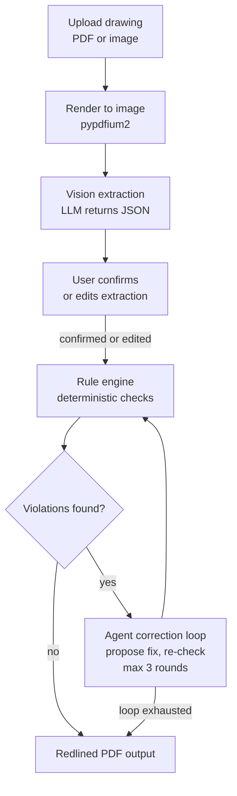

# DraftCheck — Architecture

Every item below is marked **BUILT** (exists in this repo today) or **PLANNED** (designed,
not yet written).

Last updated: 2026-10-29

## 1. Overview

DraftCheck reads an engineering drawing (PDF or image) and extracts its dimensions, GD&T
callouts, notes, and title-block data into structured JSON. It then checks that data
against a rule set covering dimensioning, GD&T, and manufacturability, and proposes a
correction for every violation it finds. The result is a redlined PDF showing each error
and the suggested fix.

## 2. Core principle

**The LLM reads and reasons; deterministic Python decides pass/fail.**

The model is used only for perception and explanation — turning pixels into structured
facts, and turning a rule violation into wording a person can act on. Whether a rule
passes is always computed in plain Python from the extracted data, so the same drawing
always produces the same verdicts. No rule outcome is ever read out of a model response.

## 3. Pipeline — PARTLY BUILT

Render, Extract, and Check work today; the stages between and after them are still planned.



Stage notes:

| Stage | What happens | Status |
| --- | --- | --- |
| Render | PDF page rasterized to an image the model can see, via `render.load_pages` | **BUILT** |
| Extract | Model returns a JSON object; parsed by `llm_parsing.extract_json`, then validated by `schema.parse_drawing`. Wired up as `pipeline.extract` | **BUILT** |
| Confirm | User reviews and edits the extracted values before any checking | PLANNED |
| Check | Python rules produce pass/fail per rule, with no model involvement, via `rules.run_rules`, wrapped as `pipeline.check` | **BUILT** |

Render → Extract → Check runs end to end today from one command, `python -m draftcheck.cli check` — see §4.3.
| Correct | Agent proposes a fix, rules re-run to verify it; **max 3 rounds**, then stop | PLANNED |
| Output | Annotated PDF with redline markup and a findings list | PLANNED |

The 3-round cap is a hard stop: if a proposed correction still fails, the finding is
reported unresolved rather than retried indefinitely.

## 4. Components

| Module | Role | Status |
| --- | --- | --- |
| `draftcheck/llm_parsing.py` | Pulls a single JSON object out of model output; strips `<think>` blocks and code fences; raises `JSONParseError` with the raw text attached | **BUILT** |
| `draftcheck/config.py` | Locates `.env` with `find_dotenv` and builds a frozen `Provider` (name, base_url, model, api_key); raises `ConfigError` naming any missing variable, and masks the key in `repr` | **BUILT** |
| `draftcheck/llm_client.py` | `LLMClient.chat(system, user)` over the OpenAI-compatible Baseten endpoint at `temperature=0`; `chat_json(system, user, images)` additionally sends PNG pages as `image_url` data URIs, parses the reply with `extract_json`, and retries once on `JSONParseError`. Both return latency, token usage, and model id | **BUILT** |
| `draftcheck/render.py` | `load_pages(path, dpi, max_side)` rasterizes a PDF with pypdfium2 or loads a PNG/JPG with pillow; returns `PageImage` (PNG bytes, width, height) per page, scaled down to `max_side` | **BUILT** |
| `draftcheck/prompts.py` | `EXTRACTION_SYSTEM` and `EXTRACTION_USER`: the model is a transcription engine that reports what is printed and never invents or repairs a callout; the user prompt fixes the JSON key set and the field rules, including each dimension's `from_ref`/`to_ref` endpoints (§4.2). Correction wording still to come | **BUILT** |
| `draftcheck/schema.py` | pydantic v2 models for the extracted drawing (`Drawing`, `Dimension`, `FCF`, `DatumFeature`, `DatumRef`, `TitleBlock`, `GeneralTolerance`) and for rule output (`Finding`); `Units` and the 14-value `Characteristic` enum, plus `FORM_CONTROLS`. `parse_drawing(data)` validates a raw extraction dict: unknown keys are ignored, missing ids become `DT1…`/`D1…`/`F1…` (datums, dimensions, frames), and any item it cannot read is dropped into `Drawing.parse_issues` | **BUILT** |
| `draftcheck/rules.py` | `Rule` dataclass (id, title, category, severity, `source`, `check`), the `RULES` registry, and `run_rules(drawing)`. Six rules today — see §4.1. Output is sorted by rule id then item ids, so the same drawing always gives the same list | **BUILT** |
| `draftcheck/pipeline.py` | The two stages of one run, with no printing and no argument parsing, so the CLI and later the API can both drive them. `extract(path, client, dpi)` renders **page 1 only**, calls `chat_json` with the extraction prompts, and validates the reply with `parse_drawing`; it returns an `ExtractionResult` (the `Drawing` plus raw reply text, latency, model id, token usage, attempts). `check(drawing)` wraps `run_rules` | **BUILT** |
| `draftcheck/cli.py` | The `check` subcommand — see §4.3. Writes the run's files, prints the findings table and any `parse_issues`, and sets the exit code | **BUILT** |
| `draftcheck/agent.py` | Correction loop: propose, re-check, stop at 3 rounds | PLANNED |
| `draftcheck/redline.py` | Overlays markup on the original PDF; library to be chosen in Layer 2 | PLANNED |
| `draftcheck/api.py` | FastAPI app: upload, confirm, results endpoints | PLANNED |
| `frontend/` | Upload page, extraction review/edit screen, findings view | PLANNED |
| `scripts/make_sample_drawing.py` | Generates a synthetic drawing (reportlab) with its ground-truth JSON and a PNG preview; seeds a known error so the rule engine has something to catch. The ground truth is written in `schema.py`'s field names — plus `bbox_convention` and `seeded_errors` — so it parses as a `Drawing` and doubles as the target an extraction is scored against | **BUILT** |
| `scripts/smoke_test.py` | One-shot check that the configured model answers over the network | **BUILT** |
| `scripts/extract_spike.py` | One extraction pass on a drawing: renders it, calls `chat_json`, and writes `outputs/spike/<name>.raw.txt`, `.json`, and `.overlay.png` (red boxes = model bboxes, green = ground truth from `--gt`). A look-at-it tool; it decides nothing | **BUILT** |

Rule text is always written in our own words with a `source` citation — no standards text
is copied into the code.

### 4.1 Rules in `rules.py` — BUILT

| Id | Title | Category | Severity | What it catches |
| --- | --- | --- | --- | --- |
| GDT-001 | Undefined datum | gdt | error | A feature control frame cites a datum letter that no datum feature symbol on the drawing defines, so the tolerance cannot be measured. One finding per frame per missing letter |
| GDT-002 | Duplicate datum | gdt | error | The same datum letter is defined more than once, so two features both claim it and an inspector cannot tell which to measure from |
| GDT-003 | Form control with datum | gdt | error | A control in `FORM_CONTROLS` (flatness, straightness, circularity, cylindricity) carries datum references. A form control describes one feature's own shape, so a datum on it has no meaning |
| GDT-004 | Position without basic dimensions | gdt | error | The drawing has a position tolerance but no basic dimensions anywhere, so no true location is established. **Drawing-level, not per-feature** — see the limitation below |
| DIM-001 | Missing units or general tolerance | dimensioning | error | Units are absent; and/or there is no general tolerance while some dimension carries none of its own and is neither basic nor reference, leaving it with no permitted range. Reports the two problems as separate findings |
| MFG-001 | Hole too close to edge | manufacturability | warning | A hole leaves less solid material between its wall and a part edge than `MIN_EDGE_MATERIAL_RATIO` × the hole diameter (1.0 today), so the web can tear out or bulge when the hole is drilled or punched. One finding per hole per failing edge |

Every finding names the offending item's id(s) and its bounding box, so the redline stage
can draw it in the right place.

#### MFG-001 — how the distance is worked out

The rule reads geometry out of each dimension's `from_ref`/`to_ref` pair (see §4.2):

- **Hole diameter** comes from a dimension whose `feature_type` is `diameter`. With more
  than one, the largest is used — a bigger hole leaves less material, so that is the
  conservative read. With none, the rule computes nothing and stays silent.
- **Material left** for a dimension running from an edge to `hole_N_center` is
  `value − diameter / 2`, i.e. the hole's wall, not its centre, to the edge.
- **The facing edge** is usually not dimensioned. When an overall size spans the part
  (`left_edge`→`right_edge`, or `bottom_edge`→`top_edge`), the distance to the opposite
  edge is derived as `overall − value`. A printed distance always wins over a derived one
  for the same hole and edge. A derived finding names both dimensions it used.

The threshold is a default, not a standard: `MIN_EDGE_MATERIAL_RATIO` in `rules.py` is
meant to be tuned per process and material.

Known limitation — GDT-004 only asks whether the drawing has any basic dimensions at all.
It cannot yet tell whether the basic dimensions present actually locate the feature a given
position frame applies to; that needs per-feature use of the `from_ref`/`to_ref` links.

### 4.2 Dimension endpoints: `from_ref` and `to_ref` — BUILT

A dimension's value alone is just a number. `from_ref` and `to_ref` say what it measures
between, which is what turns "20" into "the left edge to hole 1's centre" — the fact
MFG-001 needs. Extraction asks for one of: `left_edge`, `right_edge`, `top_edge`,
`bottom_edge`, `hole_N_center` (holes numbered left to right, then top to bottom),
`datum_X`, or `null` when the model cannot tell.

When a dimension lands on a physical edge the prompt asks for the edge name even if that
edge also carries a datum feature symbol — the rule needs geometry, and on plate_001 the
left edge is also datum B. Both fields stay optional in the schema: a drawing with no
endpoint information parses fine, and MFG-001 simply has nothing to check.

On the 2026-10-29 spike run the model filled all six of plate_001's dimensions correctly,
including both overall sizes and both hole locations.

### 4.3 The `check` command — BUILT

```
python -m draftcheck.cli check <drawing> [--from-json path] [--out dir] [--dpi n]
```

`--from-json` loads a saved extraction instead of calling the model, which makes a run
free, offline, and repeatable; it is how the CLI tests exercise the whole command. The
drawing is still rendered in that mode, so a bad path fails loudly rather than appearing
to pass on a saved extraction.

Each run writes to `--out`, defaulting to `outputs/runs/<drawing-name>/`:

| File | Contents |
| --- | --- |
| `extraction.json` | The validated `Drawing`, including `parse_issues` |
| `findings.json` | The findings list, in `run_rules` order |
| `raw.txt` | The model's reply exactly as received. **Only written when the model ran** |

Exit codes are meant for CI: `0` clean, `1` at least one error-severity finding, `2` the
run could not happen at all (unreadable drawing, bad JSON, missing config, model failure).
A warning-only run still exits `0`.

A real run on 2026-10-29, against `meta-models/muse-spark-open-1026`:

```
$ python -m draftcheck.cli check samples/generated/plate_001.pdf
Drawing:  samples/generated/plate_001.pdf
Model:    meta-models/muse-spark-open-1026
Calling the model...
Latency:  24.70s  (attempts: 1)

RULE     SEVERITY  ITEMS  MESSAGE
GDT-001  error     fcf_1  Feature control frame fcf_1 references datum C, but no datum
                          feature symbol on the drawing defines C. ...

1 error(s), 0 warning(s).
Wrote extraction.json, findings.json, raw.txt to outputs/runs/plate_001/
```

That is the error seeded into plate_001 by `scripts/make_sample_drawing.py`, found end to
end from the PDF with no hand-edited input — the first full Render → Extract → Check pass.

## 5. Repo layout (what exists today)

```
draftCheck/
├── .github/
│   └── workflows/
│       └── ci.yml              # ruff + pytest on push to main and on PRs
├── docs/
│   └── ARCHITECTURE.md         # this file
├── draftcheck/
│   ├── __init__.py
│   ├── cli.py                  # BUILT  python -m draftcheck.cli check <drawing>
│   ├── config.py               # BUILT
│   ├── llm_client.py           # BUILT
│   ├── llm_parsing.py          # BUILT
│   ├── pipeline.py             # BUILT
│   ├── prompts.py              # BUILT
│   ├── render.py               # BUILT
│   ├── rules.py                # BUILT
│   └── schema.py               # BUILT
├── samples/
│   └── generated/              # synthetic drawings, regenerable from scripts/
│       ├── plate_001.pdf       # the drawing
│       ├── plate_001.gt.json   # ground truth in schema.py field names, parses as a Drawing
│       └── plate_001.png       # rendered preview
├── outputs/                    # git-ignored; spike dumps, overlays, redlined PDFs
├── scripts/
│   ├── __init__.py
│   ├── extract_spike.py        # python -m scripts.extract_spike <drawing> [--gt ...]
│   ├── make_sample_drawing.py  # python -m scripts.make_sample_drawing
│   └── smoke_test.py           # python -m scripts.smoke_test
├── tests/
│   ├── fixtures/               # frozen inputs the tests parse
│   │   └── plate_001.model.json  # real extraction output from the 2026-10-29 spike run
│   ├── test_cli.py
│   ├── test_config.py
│   ├── test_llm_client.py
│   ├── test_llm_parsing.py
│   ├── test_pipeline.py
│   ├── test_render.py
│   ├── test_rules.py
│   ├── test_sample_drawing.py
│   └── test_schema.py
├── CLAUDE.md                   # working rules for Claude Code
├── LICENSE                     # MIT
├── README.md
├── pyproject.toml
└── requirements.txt
```

## 6. Development workflow — BUILT

1. Claude Code works on a feature branch inside a git worktree, one step at a time.
2. Aakruti reviews the change and does all git operations — Claude Code never commits,
   pushes, merges, or rebases.
3. The branch goes up as a pull request against `main`.
4. CI runs `ruff check .` and `pytest`; both must pass.
5. Branch protection on `main` requires passing CI. No review is required, since this is
   a solo project.

## 7. Decisions log

| Date | Decision | Reason |
| --- | --- | --- |
| 2026-10-27 | Muse Spark Open on Baseten as the primary model | Credits available, and it makes the project eligible for the open-weight bonus prize |
| 2026-10-27 | MIT license | Hackathon rules require a public repo; MIT makes it genuinely open source |
| 2026-10-28 | pypdfium2 to render PDFs to images; reportlab to generate synthetic test drawings | Permissive licenses; testable locally without external services |
| 2026-10-28 | Branch protection with required CI and no required review | Solo developer, so CI is the gate instead of a reviewer |
| 2026-10-28 | `.env` lives at the repo root; config uses `find_dotenv` to locate it from any worktree | One secret file, never committed, works from the main folder and Claude Code worktrees |
| 2026-10-28 | Extraction spike passed on plate_001: 6/6 dimensions, FCF correct, seeded undefined-datum error preserved | Confirms Muse Spark Open transcribes faithfully; proceed with schema and rule engine |
| 2026-10-29 | Rules are a registry of `Rule` dataclasses, and `run_rules` sorts its output by rule id then item ids | A fixed order means two runs over the same drawing are directly comparable, which is what the correction loop needs to tell whether a proposed fix actually cleared a finding |
| 2026-10-29 | Dimensions carry `from_ref`/`to_ref` endpoints, and extraction asks for the physical edge name even when that edge is also a datum | A rule needs geometry, not labels: "20 from the left edge to hole 1" is checkable, "20 from datum B" is not, and on plate_001 those are the same edge. Keeping both fields optional means a drawing without them still parses and MFG-001 simply has nothing to check |
| 2026-10-29 | `MIN_EDGE_MATERIAL_RATIO = 1.0` is a module constant, and MFG-001 is a warning rather than an error | Edge distance is shop practice, not a standard — it varies with process, material, and thickness. A named constant makes the number reviewable and tunable instead of buried, and a warning says "look at this" rather than "this is wrong" |
| 2026-10-29 | Datum feature symbols get ids (`DT1`, `DT2`, …) assigned per symbol, not per label | Findings pointed at `datum[0]`, a list position that shifts whenever extraction output changes. An id per symbol survives that, and assigning per symbol keeps two symbols claiming the same letter distinguishable — which is exactly the case GDT-002 reports |
| 2026-10-29 | The run logic lives in `pipeline.py`; `cli.py` only parses arguments, prints, and sets the exit code | The FastAPI layer needs the same two steps without a terminal attached. Keeping printing out of `pipeline` means the API can import it as-is instead of the CLI growing a second copy of the flow |
| 2026-10-29 | `extract` sends page 1 only | Every sample is a single sheet, and sending every page of a long PDF would spend tokens nobody asked for. Multi-page sheets are a later decision, not an accidental default |
| 2026-10-29 | `check` exits 1 on error-severity findings, 2 on a failed run, and still renders the drawing under `--from-json` | A reviewer needs "the drawing is wrong" and "the tool broke" to be different outcomes, which a single non-zero code cannot express. Rendering even when the extraction is loaded from disk stops a typo'd drawing path from quietly passing |
| 2026-10-29 | Lenient parsing: bad bboxes become None, unknown units become None, and an item that cannot be read at all is dropped and recorded in `Drawing.parse_issues` instead of failing the parse | Model output is imperfect; the user confirms data in the UI, and rules flag missing values instead of crashing. One unreadable callout must not cost us the rest of the drawing, and `parse_issues` keeps the loss visible rather than silent |

## 8. Status

| Layer | What it covers | State |
| --- | --- | --- |
| 1 | Extraction + JSON schema + rule engine + test generator | BUILT: JSON parser, config, LLM client, renderer, extraction prompts, sample-drawing generator, extraction spike, `schema.py`, `rules.py` with 6 rules, and `pipeline.py` + `cli.py` joining them into one `check` command that runs a drawing end to end. More rules can be added to the registry as the sample set grows |
| 2 | Agent correction loop + redlined PDF | PLANNED |
| 3 | Web UI + live deploy | PLANNED |
| 4 | After hackathon: SAM 3.1 precision, revisions, link to Research Paper Recommender | PLANNED (post-hackathon) |
